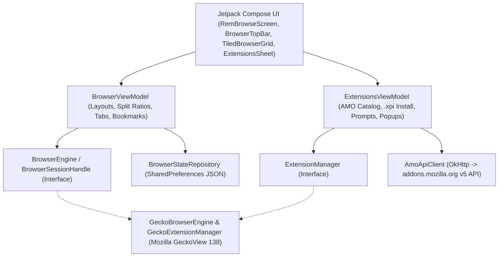

# RemBrowse Architecture Guide

## 1. High-Level Architecture (MVVM + Engine Abstraction)

RemBrowse strictly separates **UI rendering (Jetpack Compose)**, **state & business logic (pure JVM ViewModels)**, and **platform/native engine integration (GeckoView + SharedPreferences + OkHttp)** so that core logic and UI interactions are 100% testable headlessly on the JVM without native `.so` binaries.

---

## 2. Multi-Pane GeckoView Rendering & Compositor Lifecycle

Running multiple live `GeckoView` instances side by side in Jetpack Compose (`1x2`, `2x1`, `2x2`) requires three careful design invariants implemented in `GeckoBrowserEngine.kt`:

1. **TextureView Backend (`GeckoView.BACKEND_TEXTURE_VIEW`)**:
   * Standard `SurfaceView` holes can clip or z-fight with Compose rounded borders, split dividers, modal dialogs, and extension popups.
   * Every pane `GeckoView` uses `BACKEND_TEXTURE_VIEW` so multi-pane compositing and overlays render smoothly.
2. **Single-Owner Session Re-attachment (`sessionOwners`)**:
   * GeckoView throws if a `GeckoSession` is attached to a second `GeckoView` before being released from the first.
   * `GeckoBrowserEngine.attachSessionToView()` tracks session-to-view ownership in a `WeakHashMap<GeckoSession, GeckoView>` and safely detaches previous owners before attaching.
3. **Visibility vs. Extension Focus Separation**:
   * In GeckoView, `GeckoSession.setActive(false)` suspends rendering and blanks the pane surface.
   * `BrowserViewModel.syncActiveSessionFlags()` separates:
     * `setVisible(tab.id in visiblePaneIds)` → calls `session.setActive(visible)` so **all visible panes** in `1x2`/`2x1`/`2x2` stay actively painted.
     * `setFocusedForExtensions(tab.id == activeTabId)` → calls `webExtensionController.setTabActive(session, focused)` so WebExtensions know which single pane is focused.

---

## 3. Native WebExtensions (`.xpi`) Pipeline

* **Discovery (`OkHttpAmoApiClient` + `AmoJsonParser`)**:
  * Fetches real Android-compatible extensions from `https://addons.mozilla.org/api/v5/addons/search/?app=android&type=extension`.
  * Parses localized metadata (`name`, `summary`, `icon_url`, `authors`, `ratings.average`, `weekly_downloads`) and extracts the signed `.xpi` download URL from `current_version.file.url`.
* **Installation (`GeckoExtensionManager`)**:
  * Accepts HTTPS `.xpi` URLs or local `file://` URIs (copied into `cacheDir/xpi_imports/` from Android's Storage Access Framework document picker).
  * `WebExtensionController.PromptDelegate.onInstallPromptRequest()` suspends installation until the user approves or cancels the Material 3 permission dialog (`WebExtension.PermissionPromptResponse`).
* **Toolbar Actions & Popups**:
  * Each installed `WebExtension` registers a `WebExtension.ActionDelegate`.
  * Clicking an extension chip in the top bar invokes `action.click()`, which triggers `onOpenPopup`/`onTogglePopup`, spins up a dedicated popup `GeckoSession`, and displays it in `ExtensionPopupDialog`.

---

## 4. State Persistence & Testing Strategy

* **Persistence**: `SharedPrefsBrowserStateRepository` serializes `PersistedBrowserState` (layout mode, clamped horizontal/vertical split ratios, open tabs, pane assignments, active pane index, and bookmarks) as structured JSON in `SharedPreferences`.
* **Testability**:
  * Pure JVM unit tests verify `UrlResolver`, `AmoJsonParser`, `BrowserViewModel`, and `ExtensionsViewModel` using lightweight fakes (`BrowserFakes.kt`).
  * Robolectric verifies real Android `SharedPreferences` round-trip persistence (`BrowserStorageRobolectricTest`).
  * Headless Jetpack Compose + Robolectric tests (`RemBrowseUiTest`) verify `1x1` → `1x2` → `2x2` → `1x1` layout switching, Tab Bar population, tab switching, and Extensions dialog navigation.
