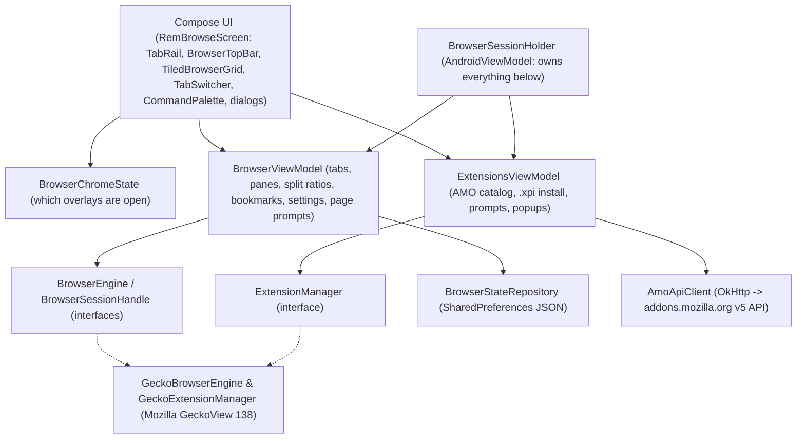

# RemBrowse Architecture Guide

## 1. High-Level Architecture (MVVM + Engine Abstraction)

RemBrowse separates **UI rendering (Jetpack Compose)**, **state and business logic (plain JVM view models)** and **platform/native engine integration (GeckoView, SharedPreferences, OkHttp)**, so the logic and the UI can be tested headlessly on the JVM without native `.so` binaries.

### Lifetime

`BrowserSessionHolder` is an `AndroidViewModel` created by `MainActivity`. It owns the engine, the extension manager and both view models, which gives live tabs the lifetime of the browser *window* rather than of one activity instance:

* If Android re-creates the activity, the same sessions are reused. Nothing is duplicated or leaked.
* When the window really goes away, `onCleared()` saves state and closes every session exactly once.
* `GeckoRuntime` itself is process-wide and lives in `RemBrowseApplication`.

`BrowserChromeState` is deliberately outside the composition so the activity's hardware-key handling (`KeyboardShortcuts`) can open the command palette or settings, or focus the address bar.

---

## 2. Tabs, panes and engine sessions

`BrowserUiState` holds the full tab list plus `paneTabIds`, the tab shown in each visible pane. `BrowserViewModel.syncSessions()` keeps the engine in step with it:

* **Lazy sessions**: a tab only gets an engine session once it is shown in a pane. Restoring twenty tabs therefore loads only the visible ones.
* **Visibility vs. focus**: `setVisible()` maps to `GeckoSession.setActive()`, so every visible pane keeps painting, while `setFocusedForExtensions()` tells WebExtensions which single tab is focused.
* **Start page**: a tab at `about:blank` is rendered natively by `NewTabPage`; no web view is composed for it until it navigates. Going back to the start of a tab's history returns to it.

### Rendering several GeckoViews

`TiledBrowserGrid` places each pane by index with explicit offsets and sizes. Pane *n* keeps its place in the composition whatever the layout, so switching layout resizes the existing `GeckoView`s instead of re-creating them. In `GeckoBrowserEngine`:

1. **TextureView backend** (`GeckoView.BACKEND_TEXTURE_VIEW`) so panes can be clipped to rounded corners and drawn under Compose overlays.
2. **Single-owner attachment**: `attachSessionToView()` tracks which view holds each session and releases the previous owner first, because a session may only be attached to one view.

### New windows

When a page calls `window.open` (or an extension calls `tabs.create`), GeckoView expects an *unopened* session back and opens it itself. `GeckoBrowserEngine.adoptNewTab()` asks the view model for a tab, and the session created during that call is flagged `awaitingGeckoOpen`: it is neither opened nor loaded by us, only returned. This keeps `window.opener` and POST data intact. If Gecko never opens it, a timeout opens it directly.

### Crashes and low memory

`ContentDelegate.onCrash`/`onKill` close a session. The handle keeps the last `SessionState` and restores it immediately for a visible tab, or lazily when a background tab is shown again. A second crash within ten seconds is treated as a crash loop: the tab is flagged `crashed` and the UI offers a manual reload.

### Page prompts and load errors

* `GeckoPagePrompts` turns Gecko's prompt requests (`alert`, `confirm`, `prompt`, HTTP authentication, `<select>`) into `PagePrompt` models. The view model queues them and the UI shows the oldest one that belongs to a visible tab.
* `NavigationDelegate.onLoadError` returns a small self-contained page built by `ErrorPages`, with everything interpolated into it HTML-escaped.

---

## 3. Native WebExtensions (`.xpi`) Pipeline

* **Discovery (`OkHttpAmoApiClient` + `AmoJsonParser`)**: queries `https://addons.mozilla.org/api/v5/addons/search/?app=android&type=extension&lang=en-US`. The parser handles AMO's locale maps (including the `null` + `_default` shape), skips entries without an id, duplicates and non-HTTPS downloads.
* **Installation (`GeckoExtensionManager`)**: accepts `https://` `.xpi` URLs or a `file://` copy of a picked document (copied off the main thread into `cacheDir/xpi_imports/` and deleted afterwards). Install errors are mapped to plain-language messages; a cancelled prompt is not an error.
* **Permission prompts**: install, update-with-new-permissions and optional-permission requests all go through one queue and the same review dialog. Nothing is approved silently.
* **Toolbar actions**: the default action (reported with a null session) and per-tab overrides are stored separately and merged for the focused tab, so one tab's badge never shows on another.
* **Tabs from extensions**: `TabDelegate.onNewTab` adopts a new browser tab; `onOpenOptionsPage` opens the options page in a tab.

---

## 4. Design tokens

All colours, type and shapes come from `ui/theme/Theme.kt`; components read `MaterialTheme` roles and never hardcode values.

| Role | Used for |
| :--- | :--- |
| `background` | Window chrome: tab rail and toolbar (`#14161B` in the dark theme) |
| `surface` | Raised elements on the chrome: address pill, menus, dialogs, cards |
| `surfaceContainerLowest` | The page container behind web content and the start page |
| `surfaceContainerHigh` / `Highest` | Hover and selected fills |
| `primary` | Accent for text, icons, focus rings, progress and selection outlines |
| `primaryContainer` | Deep accent fill for selected and active items |
| `tertiaryContainer` | Soft accent tint for the start page backdrop |
| `outline` / `outlineVariant` | Control boundaries / decorative hairlines |

`AccentColor` offers six accents; each defines tones for both themes. `ThemeContrastTest` asserts WCAG contrast (4.5:1 text, 3:1 non-text) for every theme and accent combination.

Sizes shared by the chrome are in `RemDimens`. Interactive elements have a 48dp touch target even where the visual is 40dp, and windows narrower than 600dp switch to the compact layout.

---

## 5. State Persistence & Testing Strategy

* **Persistence**: `SharedPrefsBrowserStateRepository` stores `PersistedBrowserState` (layout, clamped split ratios, tabs, pane assignments, bookmarks and settings) as JSON. Data written by older versions loads with defaults for missing fields. Split ratios are saved once per drag, not on every pointer move.
* **Unit tests (plain JVM)**: `UrlResolver`, `KeyboardShortcuts`, `ErrorPages`, `AmoJsonParser`, command palette results, theme contrast, and both view models against the fakes in `BrowserFakes.kt`.
* **Robolectric**: real `SharedPreferences` round trips.
* **Headless Compose UI tests**: `RemBrowseUiTest` (laptop-sized window) and `CompactWindowUiTest` (phone-sized) drive the real screen with a fake engine.
* **UI renders**: `UiSnapshotTest` writes PNGs of the main screens on request (see the Build & Test Guide).

Behaviour that depends on the real engine (new-window adoption, crash recovery, prompts, extension delegates) is written against the GeckoView 138 sources and compiled against the real library, but is not exercised by automated tests: it needs a device.
