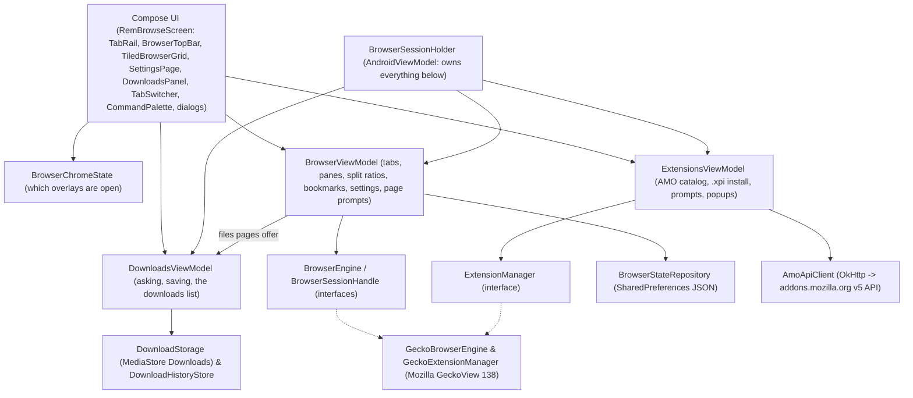

# RemBrowse Architecture Guide

## 1. High-Level Architecture (MVVM + Engine Abstraction)

RemBrowse separates **UI rendering (Jetpack Compose)**, **state and business logic (plain JVM view models)** and **platform/native engine integration (GeckoView, SharedPreferences, OkHttp)**, so the logic and the UI can be tested headlessly on the JVM without native `.so` binaries.

### Lifetime

`BrowserSessionHolder` is an `AndroidViewModel` created by `MainActivity`. It owns the engine, the extension manager and the three view models, which gives live tabs the lifetime of the browser *window* rather than of one activity instance:

* If Android re-creates the activity, the same sessions are reused. Nothing is duplicated or leaked.
* When the window really goes away, `onCleared()` saves state and closes every session exactly once.
* `GeckoRuntime` itself is process-wide and lives in `RemBrowseApplication`.

`BrowserChromeState` is deliberately outside the composition so the activity's hardware-key handling (`KeyboardShortcuts`) can open the command palette or settings, or focus the address bar.

---

## 2. Tabs, panes and engine sessions

`BrowserUiState` holds the full tab list plus `paneTabIds`, the tab shown in each visible pane. `BrowserViewModel.syncSessions()` keeps the engine in step with it:

* **Lazy sessions**: a tab only gets an engine session once it is shown in a pane. Restoring twenty tabs therefore loads only the visible ones.
* **Visibility vs. focus**: `setVisible()` maps to `GeckoSession.setActive()`, so every visible pane keeps painting, while `setFocusedForExtensions()` tells WebExtensions which single tab is focused.
* **Start page**: a tab at `about:blank` is rendered natively by `NewTabPage`; no web view is composed for it until it navigates. Going back to the start of a tab's history returns to it.

### Internal pages (`rem://`)

RemBrowse's own pages are tabs whose address starts with `rem://`. Today that is the settings page: `rem://settings/<section>`, one address per `SettingsSection`. `TiledBrowserGrid` hands such a tab to the `internalPage` slot, where `RemBrowseScreen` draws `SettingsPage` (with `ExtensionsPanel` embedded as its Extensions section), instead of composing a web view.

The web engine is kept out of it entirely:

* **No engine session.** `syncSessions()` and `openNewTab()` skip internal tabs, and `showInternalPage()` closes the session of the start page it replaces. This is not only a saving: a `GeckoSession` reports `about:blank` when it opens, and that update would turn the settings tab back into the start page. For the same reason `onSessionUpdated` ignores anything that still arrives for a tab showing an internal page.
* **Never loaded by Gecko.** `navigatePane()` routes a typed `rem://` address to `openSettings()`. That reuses the settings tab if there is one, converts an untouched start page in place, and otherwise opens a new tab, so a website and its history are never replaced.
* **Not reachable from web content.** `onNewTabRequested` (from `window.open`, `target=_blank` or an extension's `tabs.create`) refuses `rem://` addresses, and no tab is created.
* **Back to the web.** Typing a web address on the settings tab creates a session for it at that point and marks it visible.

Because the section is the tab's URL, it is saved and restored with the rest of the tab state.

### Rendering several GeckoViews

`TiledBrowserGrid` places each pane by index with explicit offsets and sizes. Pane *n* keeps its place in the composition whatever the layout, so switching layout resizes the existing `GeckoView`s instead of re-creating them. In `GeckoBrowserEngine`:

1. **TextureView backend** (`GeckoView.BACKEND_TEXTURE_VIEW`) so panes can be clipped to rounded corners and drawn under Compose overlays.
2. **Single-owner attachment**: `attachSessionToView()` tracks which view holds each session and releases the previous owner first, because a session may only be attached to one view.

### Page width in a pane

A tab that asks for desktop sites uses `VIEWPORT_MODE_DESKTOP`, which sets `forceDesktopViewport` on its browsing context. Gecko then lays the page out at `max(width of the view, browser.viewport.desktopWidth)` CSS px and scales it to fit the view (`Document::GetViewportInfo`). With Gecko's default of 980, a pane narrower than 980 px shows every page as a 980 px layout shrunk to fit, so its text is small.

GeckoView 138 has no setter for that preference, so `EngineConfig` passes it in the startup configuration file GeckoView reads (`GeckoRuntimeSettings.Builder.configFilePath`). The file's `prefs` are applied as default preference values through `MOZ_DEFAULT_PREFS` before the engine starts, in release builds too.

* On screens whose smallest side is at least 600dp the preference is set to 320, so the viewport follows the pane's real width and pages reflow at their natural size, as in a desktop browser with a narrow window. Panes wider than 980 px already used their own width.
* Phones keep 980: there, a desktop site is expected to be fitted to the screen.
* The file is written to the app's files directory at each start and read back with GeckoView's own parser (`DebugConfig`) before its path is handed over. If writing or parsing fails in any way, the engine starts without it. `proguard-rules.pro` keeps SnakeYAML whole so the parser cannot be shrunk away.

### Split view

`BrowserViewModel.splitCurrentTab()` puts the focused tab into a two-pane layout on the requested side and keeps focus on it; `swapFocusedPane()` and `setSplitPreset()` back the controls in the Split menu. That menu (`SplitMenu` in `BrowserTopBar`) is the only place the split's controls live: with one page on screen it lists the ways to split, and while a split is open it lists swap, the size presets (two panes only), the layouts and Close split. No row is drawn above the panes, and panes have no toolbars of their own: the single address bar reads `activeTab`, so it always shows and acts on the focused pane, which is marked by its outline and in the tab rail.

### New windows

When a page calls `window.open` (or an extension calls `tabs.create`), GeckoView expects an *unopened* session back and opens it itself. `GeckoBrowserEngine.adoptNewTab()` asks the view model for a tab, and the session created during that call is flagged `awaitingGeckoOpen`: it is neither opened nor loaded by us, only returned. This keeps `window.opener` and POST data intact. If Gecko never opens it, a timeout opens it directly.

### Crashes and low memory

`ContentDelegate.onCrash`/`onKill` close a session. The handle keeps the last `SessionState` and restores it immediately for a visible tab, or lazily when a background tab is shown again. A second crash within ten seconds is treated as a crash loop: the tab is flagged `crashed` and the UI offers a manual reload.

### Keyboard focus

Focus is always handed somewhere deliberate, never just cleared. Clearing it lets Android give focus to the first focusable control in the window, and the release of the key that was being pressed (Enter, typically) then activates that control. `BrowserChromeState.focusContent()` is called when a text field is done: Enter or Esc in the address bar, or the tab switcher closing. The focused pane takes Compose focus first, so the text field lets go, and a web page's `GeckoView` is then focused inside it. `MainActivity.dispatchKeyEvent` additionally swallows the key-up of an Enter that submitted a text field, so the page never receives a stray key release.

### Tracking protection

Standard protection (`AntiTracking.DEFAULT`) is always on. The optional enhanced level adds the cryptomining, fingerprinting and email-tracker lists. Neither uses `AntiTracking.CONTENT`/`STRICT` or `EtpLevel.STRICT`: that list contains general-purpose hosts (`cloudflare.com`, `gstatic.com`, `google.com`, `cdn.jsdelivr.net`), and blocking it breaks Cloudflare's bot check, reCAPTCHA and much of the web.

### Page prompts and load errors

* `GeckoPagePrompts` turns Gecko's prompt requests (`alert`, `confirm`, `prompt`, HTTP authentication, `<select>`, file inputs) into `PagePrompt` models. The view model queues them and the UI shows the oldest one that belongs to a visible tab.
* **File inputs** (`onFilePrompt`) become `PagePrompt.FilePicker`. Instead of a dialog, `RemBrowseScreen` calls `onPickFiles` once per request and `MainActivity` opens the system picker (`OpenDocument` or `OpenMultipleDocuments`, with the page's MIME types); the request id is kept in `BrowserSessionHolder` so a re-created activity neither opens it twice nor loses the answer. GeckoView resolves a picked document to a shared-storage path, which the app cannot open under scoped storage, so `UploadCache` copies each file under its own name into `cacheDir/uploads/<uuid>/` off the main thread and the prompt is confirmed with those `file://` copies. Copies are deleted when the engine starts. Folder inputs (`webkitdirectory`) are dismissed.
* `NavigationDelegate.onLoadError` returns a small self-contained page built by `ErrorPages`, with everything interpolated into it HTML-escaped.

### Tab settings

`BrowserSettings` carries three choices the view model applies itself:

* `restoreTabsOnStartup`: when off, `restoreInitialState()` ignores the saved tabs and layout and starts on one start page. Bookmarks and settings are still loaded. "Startup" means a new `BrowserViewModel`, which is a new process or window, not an activity re-creation.
* `openNewTabsNextToCurrent`: `openNewTab()` inserts after the tab it is opened from. For a window a page asked for, that is the opener, even if the opener is not on screen.
* `desktopSiteByDefault`: the default for `createTabModel()`. Changing it also updates tabs that hold no website yet, so the next address typed into them uses it. A tab opened by a page inherits its opener's mode instead.

---

## 3. Downloads

A response Gecko cannot display arrives in `ContentDelegate.onExternalResponse`. `downloadRequestFrom()` turns it into a `DownloadRequest` (file name, type, size and the body stream), the session listener passes it to `BrowserViewModel.downloadHandler`, and `BrowserSessionHolder` points that at `DownloadsViewModel`.

* **Nothing is trusted.** `DownloadFileNames` takes the name from `Content-Disposition` (RFC 6266, `filename*` first) or the last path segment, then reduces it to a plain file name: no directories, no reserved characters, no leading dot, bounded length. Header names are matched in any letter case, and a missing or nonsensical size becomes "unknown".
* **Asking costs nothing.** GeckoView keeps the response's network channel suspended until the first `read()`, so the request can wait in `pendingRequests` while `DownloadPromptDialog` is on screen. Declining just closes the stream. At most five unanswered requests are held; further ones are declined. Gecko's `skipConfirmation` (a PDF viewer's save button) and the **Ask before downloading** setting bypass the question.
* **Copying** runs on `Dispatchers.IO` as plain blocking code: `DownloadStorage.create()`, read to the end, `commit()`. Progress is published in 256 KB steps rather than per chunk. Any exception, or a cancel flag set from the UI, ends in `discard()`, so a partial file never stays behind. Cancelling also closes the stream from another IO coroutine to wake a `read()` that is waiting on the network.
* **Storage** is `AndroidDownloadStorage`. On Android 10+ it inserts into `MediaStore.Downloads` with `IS_PENDING` set until the last byte is written, which needs no storage permission and lets MediaStore number a taken name. The MIME type passed is the one that belongs to the file name's own extension, because MediaStore appends an extension when the two disagree. Before Android 10 there is no permission-free shared folder, so files go to the app's external `Download` directory and are opened through a `FileProvider`.
* **The list** is `DownloadsUiState.items`, newest first and capped at 50. Finished entries are saved by `SharedPrefsDownloadHistoryStore`; an entry saved as running is loaded as failed, since a download cannot outlive the process. A `data:` address is stored as just its scheme.
* **Opening** a file is an `ACTION_VIEW` intent with a read grant, sent by `MainActivity` after the view model has checked, off the main thread, that the file still exists.
* **Leftover tabs.** A `target=_blank` link to a file opens a tab in which nothing ever loads. The view model records which tabs the engine has shown a document in (a location reported outside a page start, other than a new session's `about:blank`), and `closeTabLeftBehindByDownload()` closes a page-opened tab that is not among them. It does so once the request is over (saved, failed or declined), not before: whether the response body survives its window closing is not something the code relies on.

Downloads live in the browser process; there is no foreground service, so a download ends if the process does.

---

## 4. Native WebExtensions (`.xpi`) Pipeline

* **Discovery (`OkHttpAmoApiClient` + `AmoJsonParser`)**: queries `https://addons.mozilla.org/api/v5/addons/search/?app=android&type=extension&lang=en-US`. The parser handles AMO's locale maps (including the `null` + `_default` shape), skips entries without an id, duplicates and non-HTTPS downloads.
* **Installation (`GeckoExtensionManager`)**: accepts `https://` `.xpi` URLs or a `file://` copy of a picked document (copied off the main thread into `cacheDir/xpi_imports/` and deleted afterwards). Install errors are mapped to plain-language messages; a cancelled prompt is not an error.
* **Permission prompts**: install, update-with-new-permissions and optional-permission requests all go through one queue and the same review dialog. Nothing is approved silently.
* **Toolbar actions**: the default action (reported with a null session) and per-tab overrides are stored separately and merged for the focused tab, so one tab's badge never shows on another. The merged action's icon (or the extension's own icon when the action has none) is rendered with `Image.getBitmap()` and carried on `InstalledExtension.icon`. GeckoView builds a new `Image` for every action update, so renders are coalesced (one per extension at a time, changes wait 300 ms) and a bitmap that looks the same as the last one is not published, together with the badge and the badge colours the extension chose. `TabRail` shows these buttons at its foot, as many as fit below room for two tabs and the new-tab button (at most four, and at least one, the rest behind an overflow button); compact windows list them in the More menu.
* **Popups**: `onOpenPopup`/`onTogglePopup` return a fresh `GeckoSession` that `ExtensionPopupDialog` shows in a `GeckoView`; on windows with the rail the dialog's window is moved to the bottom corner on the rail's side, beside the extension buttons, and the page is not dimmed. The placement is set in both directions, because the activity handles resizing itself and an open popup can outlive the switch to a phone-sized layout.
* **Popup viewport helper**: popups written for desktop Firefox rarely carry `<meta name="viewport">`, and GeckoView then lays them out 980 CSS px wide and zooms them out to fit the popup (`Document::GetViewportInfo`). GeckoView has no per-session setting for this. RemBrowse ships a built-in extension (`app/src/main/assets/extensions/popup_viewport/`, installed with `WebExtensionController.ensureBuiltIn()` and hidden from the extension list) whose `addon_child` experiment API runs in the extension process. It watches `document-element-inserted` and, for top-level `moz-extension:` documents whose frame data says `viewType: "popup"`, inserts `width=device-width` (without an initial scale, so content wider than the popup is still scaled down to fit rather than scrolled sideways). A popup's own viewport tag is parsed later and takes precedence, and pages of extensions shown in tabs are not touched. If the helper cannot be installed, popups open as before. On large screens `EngineConfig`'s lower `browser.viewport.desktopWidth` (see above) already makes that fallback layout follow the popup's width; the helper also covers phones, which keep 980, and does not depend on the configuration file being applied. `BuiltInExtensionAssetsTest` checks the package's id, files and API wiring.
* **Proxy settings on Android**: Firefox's `proxy.settings` code (`toolkit/components/extensions/parent/ext-proxy.js`) throws "proxy.settings is not supported on android." (Mozilla bug 1725981), which stops VPN extensions such as Proton VPN, since they claim the proxy setting before routing requests through `proxy.onRequest` (supported on Android). The `PatchGeckoOmniJa` build step in `app/build.gradle.kts` transforms the merged assets (`SingleArtifact.ASSETS`) and rewrites that script inside GeckoView's `omni.ja` (`PATCHES`): its two Android checks become `false`; `get()`'s read of `network.proxy.share_proxy_settings`, a preference only desktop Firefox defines (the read throws on Android), falls back to its desktop default `false`; and `set()`'s `Services.policies.isAllowed(...)` is guarded with `Services.policies &&`, as Gecko does elsewhere, since Android builds have no enterprise-policy service. Run in a simulated Android environment (platform `android`, no policy service, GeckoView's own default preferences), the patched script accepts Proton VPN's request and reports `controlled_by_this_extension`; with only the two Android checks removed, `set()` and `get()` both still throw. Every other entry is copied unchanged, in order, with the same compression method and no data descriptors. The step fails the build if either check is not found exactly once, and re-reads the archive to verify that only that script changed. Gecko discards its startup cache when the app's install folder changes, which every update does, so the patched script is the one that runs.
* **Private browsing permission**: `proxy.settings.set` also requires `privateBrowsingAllowed`. RemBrowse has no private mode (`usePrivateMode(false)`), so `GeckoExtensionManager` grants it on install (`PermissionPromptResponse(allow, allow)`) and, once per run, to installed extensions that lack it (`setAllowedInPrivateBrowsing`, which reloads the extension; tabs the extension opens during that restart are suppressed). If private browsing is ever added, this must become the user's choice.
* **Tabs from extensions**: `TabDelegate.onNewTab` adopts a new browser tab; `onOpenOptionsPage` opens the options page in a tab.
* **Default ad blocker**: on first launch `ExtensionsViewModel` installs AdGuard AdBlocker (`DefaultAdBlocker`) through `ExtensionManager.installTrusted()`. The permission review is skipped only for a package whose id matches the expected one, and the extension's welcome tab is suppressed for the first 30 seconds. `DefaultExtensionStore` records that this happened, so a blocker the user removes is not reinstalled; a failed first attempt is silent and retried on the next launch. It is installed from addons.mozilla.org rather than bundled, which keeps the APK small, always gives the current signed build and avoids redistributing its GPL-licensed code.

---

## 5. Design tokens

All colours, type and shapes come from `ui/theme/Theme.kt`; components read `MaterialTheme` roles and never hardcode values.

| Role | Used for |
| :--- | :--- |
| `background` | Window chrome: tab rail and toolbar (`#14161B` in the dark theme) |
| `surface` | Raised elements on the chrome: address pill, menus, dialogs, cards |
| `surfaceContainerLowest` | The page container behind web content and the start page |
| `surfaceContainerHigh` / `Highest` | Hover and selected fills |
| `primary` | Accent for text, icons, focus rings, progress and selection outlines |
| `primaryContainer` | Deep accent fill for selected and active items |
| `tertiaryContainer` | Soft accent tint for the start page backdrop |
| `outline` / `outlineVariant` | Control boundaries / decorative hairlines |

`AccentColor` offers six accents; each defines tones for both themes. `ThemeContrastTest` asserts WCAG contrast (4.5:1 text, 3:1 non-text) for every theme and accent combination.

Sizes shared by the chrome are in `RemDimens`. Interactive elements have a 48dp touch target even where the visual is 40dp, and windows narrower than 600dp switch to the compact layout.

---

## 6. State Persistence & Testing Strategy

* **Persistence**: `SharedPrefsBrowserStateRepository` stores `PersistedBrowserState` (layout, clamped split ratios, tabs, pane assignments, bookmarks and settings, including the chosen search engine) as JSON. Data written by older versions loads with defaults for missing fields. Split ratios are saved once per drag, not on every pointer move.
* **Unit tests (plain JVM)**: `UrlResolver`, `KeyboardShortcuts`, `ErrorPages`, `DownloadFileNames`, download request parsing, the engine configuration file (read back with GeckoView's real parser), `AmoJsonParser`, command palette results, theme contrast, and the three view models against the fakes in `BrowserFakes.kt` (including a fake download storage and a response body that can fail or be cancelled part-way).
* **Robolectric**: real `SharedPreferences` round trips for browser state and the downloads list.
* **Headless Compose UI tests**: `RemBrowseUiTest` (laptop-sized window) and `CompactWindowUiTest` (phone-sized) drive the real screen with a fake engine, including the extension buttons on the rail and in the More menu.
* **UI renders**: `UiSnapshotTest` writes PNGs of the main screens on request (see the Build & Test Guide).

Behaviour that depends on the real engine or the device (new-window adoption, crash recovery, prompts, extension delegates and popups, the popup viewport helper, the download callback, MediaStore and opening files) is written against the GeckoView 138 sources and compiled against the real library, but is not exercised by automated tests: it needs a device.
