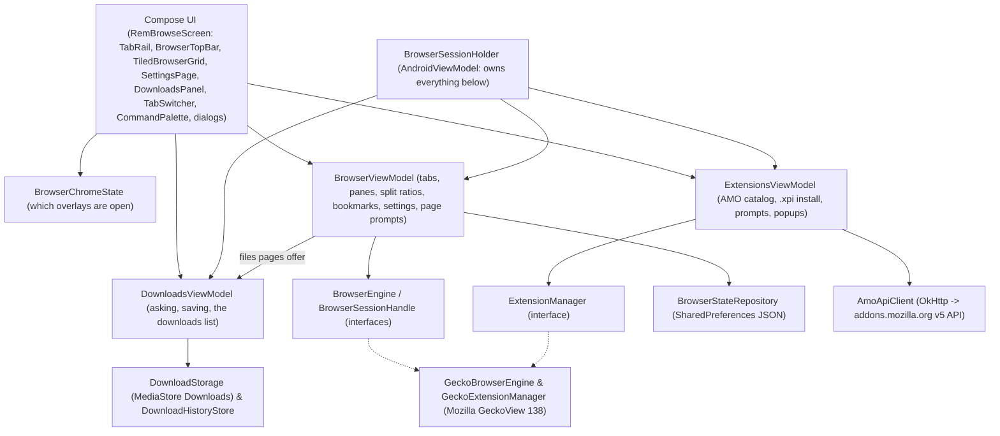
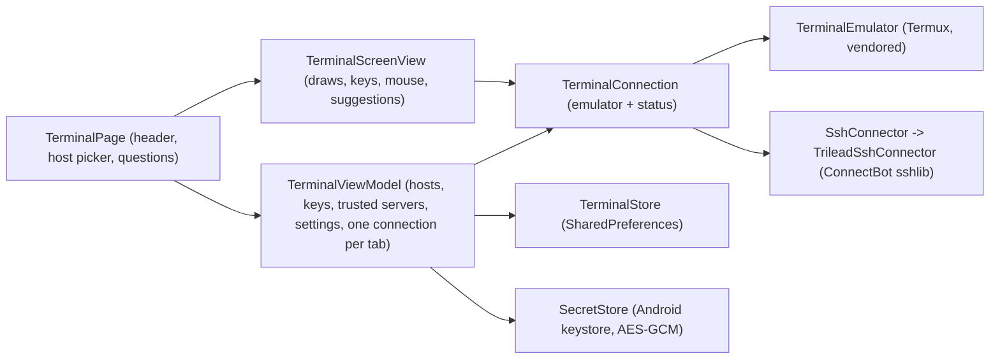

# RemBrowse Architecture Guide

## 1. High-Level Architecture (MVVM + Engine Abstraction)

RemBrowse separates **UI rendering (Jetpack Compose)**, **state and business logic (plain JVM view models)** and **platform/native engine integration (GeckoView, SharedPreferences, OkHttp)**, so the logic and the UI can be tested headlessly on the JVM without native `.so` binaries.

### Lifetime

`BrowserSessionHolder` is an `AndroidViewModel` created by `MainActivity`. It owns the engine, the extension manager and the three view models, which gives live tabs the lifetime of the browser *window* rather than of one activity instance:

* If Android re-creates the activity, the same sessions are reused. Nothing is duplicated or leaked.
* When the window really goes away, `onCleared()` saves state and closes every session exactly once.
* `GeckoRuntime` itself is process-wide and lives in `RemBrowseApplication`.

`BrowserChromeState` is deliberately outside the composition so the activity's hardware-key handling (`KeyboardShortcuts`) can open the command palette or settings, or focus the address bar.

---

## 2. Tabs, panes and engine sessions

`BrowserUiState` holds the full tab list plus `paneTabIds`, the tab shown in each visible pane. `BrowserViewModel.syncSessions()` keeps the engine in step with it:

* **Lazy sessions**: a tab only gets an engine session once it is shown in a pane. Restoring twenty tabs therefore loads only the visible ones.
* **Visibility vs. focus**: `setVisible()` maps to `GeckoSession.setActive()`, so every visible pane keeps painting, while `setFocusedForExtensions()` tells WebExtensions which single tab is focused.
* **Start page**: a tab at `about:blank` is rendered natively by `NewTabPage`; no web view is composed for it until it navigates. Going back to the start of a tab's history returns to it.

### Internal pages (`rem://`)

RemBrowse's own pages are tabs whose address starts with `rem://`. Today that is the settings page: `rem://settings/<section>`, one address per `SettingsSection`. `TiledBrowserGrid` hands such a tab to the `internalPage` slot, where `RemBrowseScreen` draws `SettingsPage` (with `ExtensionsPanel` embedded as its Extensions section), instead of composing a web view.

The web engine is kept out of it entirely:

* **No engine session.** `syncSessions()` and `openNewTab()` skip internal tabs, and `showInternalPage()` closes the session of the start page it replaces. This is not only a saving: a `GeckoSession` reports `about:blank` when it opens, and that update would turn the settings tab back into the start page. For the same reason `onSessionUpdated` ignores anything that still arrives for a tab showing an internal page.
* **Never loaded by Gecko.** `navigatePane()` routes a typed `rem://` address to `openSettings()`. That reuses the settings tab if there is one, converts an untouched start page in place, and otherwise opens a new tab, so a website and its history are never replaced.
* **Not reachable from web content.** `onNewTabRequested` (from `window.open`, `target=_blank` or an extension's `tabs.create`) refuses `rem://` addresses, and no tab is created.
* **Back to the web.** Typing a web address on the settings tab creates a session for it at that point and marks it visible.

Because the section is the tab's URL, it is saved and restored with the rest of the tab state.

### Rendering several GeckoViews

`TiledBrowserGrid` lays every pane out in one flat box with explicit offsets and sizes computed from the layout tree (`PaneNode.geometry()`), and keys each pane by the tab it shows. Whatever happens to the layout (a split, a closed pane, a tab dragged to another pane, fullscreen), the `GeckoView` of a tab that stays on screen is moved and resized, never re-created. A pane that starts showing a different tab gets a new view, and the old one is detached. In `GeckoBrowserEngine`:

1. **TextureView backend** (`GeckoView.BACKEND_TEXTURE_VIEW`) so panes can be clipped to rounded corners and drawn under Compose overlays. GeckoView 138's `SurfaceViewWrapper` treats every frame a TextureView shows (`onSurfaceTextureUpdated`) as a new surface: a new `Surface`, then `GeckoSession.onSurfaceChanged` and a blocking `syncResumeResizeCompositor` that rebuilds the EGL surface and forces a frame, for every frame of a scroll. `PageSurface.kt` wraps GeckoView's texture listener (`OncePerTextureListener`) so only available, size-changed and destroyed reach it, which is the life a SurfaceView's surface has. The one exception is recovery: when the compositor cannot use its surface it calls `GeckoView.requestNewSurface`, which only provokes a frame callback for a texture, so `PaneGeckoView` lets the next frame through (extension popups use `PaneGeckoView` too). The **Page rendering** setting (`PageRendering`) chooses Standard (that fix), Direct (GeckoView's default SurfaceView: no rounded-corner clipping, so the corners are painted over the page; a pane under a fullscreen page drops its view, since surfaces are ordered behind the window) or Legacy (the texture untouched). Views are keyed on the setting, so open panes switch at once; extension popups stay textures.
2. **Single-owner attachment**: `attachSessionToView()` tracks which view holds each session and releases the previous owner first, because a session may only be attached to one view.

### Page width in a pane

A tab that asks for desktop sites uses `VIEWPORT_MODE_DESKTOP`, which sets `forceDesktopViewport` on its browsing context. Gecko then lays the page out at `max(width of the view, browser.viewport.desktopWidth)` CSS px and scales it to fit the view (`Document::GetViewportInfo`). With Gecko's default of 980, a pane narrower than 980 px shows every page as a 980 px layout shrunk to fit, so its text is small.

GeckoView 138 has no setter for that preference, so `EngineConfig` passes it in the startup configuration file GeckoView reads (`GeckoRuntimeSettings.Builder.configFilePath`). The file's `prefs` are applied as default preference values through `MOZ_DEFAULT_PREFS` before the engine starts, in release builds too.

* On screens whose smallest side is at least 600dp the preference is set to 320, so the viewport follows the pane's real width and pages reflow at their natural size, as in a desktop browser with a narrow window. Panes wider than 980 px already used their own width.
* Phones keep 980: there, a desktop site is expected to be fitted to the screen.
* On every device the same file also sets `browser.translations.enable` to false. RemBrowse has no page translation, but the machinery GeckoView turns on runs a language-detection worker (`translations/cld-worker.js`) in every web content process, about 17 MB each as measured with `about:memory`.
* On every device it also sets `browser.navigation.requireUserInteraction` to false (see **Back** below) and `dom.suspend_inactive.enabled` to false (see **Pages nobody can see**), and `dom.webkitBlink.filesystem.enabled` to true (see **Screenshots**).
* The file is written to the app's files directory at each start and read back with GeckoView's own parser (`DebugConfig`) before its path is handed over. If writing or parsing fails in any way, the engine starts without it. `proguard-rules.pro` keeps SnakeYAML whole so the parser cannot be shrunk away.

### Split view

The layout is a tree (`model/PaneLayout.kt`): a `PaneNode` is either a `Leaf(tabId)` or a `Split(ROW | COLUMN, ratio, first, second)`, with at most four leaves. Pane indices are the leaves in reading order. `BrowserUiState.layout` is the source of truth; `paneTabIds` and `paneCount` are derived from it, and `layoutMode` is the preset the tree matches, or null for a custom shape. Presets (`LayoutMode`, the Split menu, `Ctrl+1`–`5`) build trees; `SPLIT_1_2` is `Split(ROW, Leaf, Split(COLUMN, Leaf, Leaf))`. Each split's ratio is clamped to 0.2–0.8, and `PaneNode.sanitized()` drops closed tabs, duplicates and anything past four panes, so a restored or edited tree is always valid.

**Dividers.** One divider per split, keyed by its path and orientation, so a split that turns gets a fresh gesture for the other axis. `detectDividerGestures` (in `TiledBrowserGrid.kt`) measures the pointer's travel from the press in window coordinates and sets the ratio from where the drag began (`setSplitRatio`, clamped), rather than adding up step deltas. That keeps the divider under the pointer, and after a limit it moves again only when the pointer returns. A mouse starts dragging after Compose's mouse slop, a finger after the touch slop; a press released within the touch slop is a click, and two within the double-tap timeout reset the split. Only the primary button drags. The grid's root box carries a `pointerHoverIcon` that pins the resize cursor while a divider is held. It is also the stationary node on the pointer's hit path: Compose delivers a move only if some node on the path sees its position change in its own coordinates, and a divider that keeps up with the pointer sees none, so without it moves of equal steps would be dropped. Android asks the innermost view for the cursor first, and Compose sets it only on the view hosting the whole screen, so `PaneGeckoView` and `TerminalScreenView` return no cursor while `ChromePointerIconClaim` is held (the pointer is over a divider's grab area, which overlaps the pages, or a divider is being dragged; for terminals, also over the cards and banners drawn on top of one).

**Drag and drop.** `Modifier.tabDragSource` (in `TabDrag.kt`) watches a rail tile's pointer on the Initial pass without consuming anything until a drag starts: with a mouse after the touch slop, with a finger only after a long press, so taps, the tile's menu and scrolling the rail still work. `TabDragState` holds the dragged tab and pointer position. The grid sets its `hitTest`, which maps a position to a `PaneDropTarget`: the outer quarter of a pane on each side is an edge zone, the rest is the centre. `BrowserViewModel.dropTabOnPane()` splits the pane on that side, or shows the tab in it; a tab already on screen is moved, and the leaf it left is removed. When four panes are on screen only the centre is offered, unless the dragged tab is one of them.

**Persistence.** The tree is saved as JSON next to the legacy `layoutMode`, `paneTabIds` and ratios, which are still written (`SPLIT_1_2` and any custom three- or four-pane layout as `GRID_2X2`, which older versions know) so an older version can read the state. A state without a tree, or with an unreadable one, is rebuilt from the legacy fields.

**Fullscreen.** `ContentDelegate.onFullScreen` reaches `BrowserViewModel` as `onFullScreenChanged`, which sets `fullscreenTabId` for a tab that is on screen (a hidden tab asking is told to exit). It is cleared when the page leaves fullscreen, the tab closes or crashes, or its pane stops showing it; `exitFullscreen()` (Back) calls `GeckoSession.exitFullScreen()`. While it is set, the screen drops the rail, the toolbar and the safe-drawing padding, and the grid draws that pane over the whole area. The other panes stay composed underneath, without semantics, focus or pointer input, and their sessions are made inactive until fullscreen ends; the layout itself is never changed. `MainActivity` hides the system bars (transient on swipe) and, on Android 15 and newer in a freeform window, calls `requestFullscreenMode(FULLSCREEN_MODE_REQUEST_ENTER)` so the window covers the screen, giving it back on exit. Both go through `FullscreenWindowEffect`, which fixes the value per effect so every enter is matched by one exit; reading the `by` state in `onDispose` instead saw it already false, and 0.13 never restored the window.

`splitCurrentTab()` puts the focused tab into a two-pane layout on the requested side and keeps focus on it; `swapFocusedPane()`, `setSplitPreset()` and `closePane()` back the controls in the Split menu. That menu (`SplitMenu` in `BrowserTopBar`) is the only place the split's controls live: with one page on screen it lists the ways to split, and while a split is open it lists swap, the size presets (two panes only), the layouts and Close split. No row is drawn above the panes, and panes have no toolbars of their own: the single address bar reads `activeTab`, so it always shows and acts on the focused pane, which is marked by its outline and in the tab rail. A pane becomes the focused one at the start of a gesture over it, watched on the Initial pass without consuming it (`activatesPane`, `TiledBrowserGrid.kt`): a press, or the start of a pan or a zoom (`PointerEventType.PanStart`, `ScaleStart`), which is how Compose 1.13 reports a touchpad's two-finger scroll and pinch on Android 14 and later, with nothing pressed. The page's `GeckoView` takes Android's focus for those too (its `onTouchEvent` asks for it on every press it is handed), so without them the typing went to a pane scrolled with two fingers while the address bar and the shortcuts acted on the other. Hovering and a mouse wheel leave the focused pane alone.

### New windows

When a page calls `window.open` (or an extension calls `tabs.create`), GeckoView expects an *unopened* session back and opens it itself. `GeckoBrowserEngine.adoptNewTab()` asks the view model for a tab, and the session created during that call is flagged `awaitingGeckoOpen`: it is neither opened nor loaded by us, only returned. This keeps `window.opener` and POST data intact. If Gecko never opens it, a timeout opens it directly. When that page calls `window.close()`, GeckoView asks the browser (`ContentDelegate.onCloseRequest`; Gecko only allows it for windows opened by script), and `onCloseRequested` closes the tab if a page opened it (`openedByPage`), first putting the page that opened it back in that pane (`openers` remembers who opened whom). Before 0.13.7 this was not implemented, and a finished "Sign in with Google" popup stayed open as a tab.

### Find in page

Esc closes the bar wherever the focus is (since 0.13.15). Gboard can keep Esc, or Android turn a physical keyboard's Esc into Back, before the page or the bar sees it, so `BrowserKeys.interceptEscapeForFindBar()` reads it first, from `ShortcutKeysLayout.dispatchKeyEventPreIme` and from `MainActivity.dispatchKeyEvent`: `escapeClosesFindBar()` (`KeyboardShortcuts.kt`) takes Esc, or Back from a physical keyboard up to Android 12L (`physicalBackIsEscape()`), with no modifiers and no repeat, outside terminals, unless the address bar, tab search, the tab switcher or a fullscreen page owns it. From Android 13 predictive back is on and `ViewRootImpl`'s `NativePreImeInputStage` hands a `KEYCODE_BACK` to the newest `OnBackInvokedCallback` before the window's pre-IME stage: Android 13 to 15 and 17 finish its press there (the window never sees it), and Android 16 and 16 QPR1 pass the press on but invoke the callback on the release anyway, so a Back key closes the bar through its `BackHandler` instead (after the on-screen keyboard, when that is up). The key-down closes the bar and focuses the page; its repeats and key-up are swallowed, and a fresh key-down is judged again, so a lost key-up can't swallow the next press. Back from the screen goes through a `BackHandler` that yields to the tab switcher and fullscreen, and the bar's field closes on `Key.Back` too.

`BrowserViewModel.findInPage` (a `FindInPageState` flow of its own, so typing does not recompose the screen) belongs to the focused tab; `syncSessions()` closes it when focus moves on. Searches go to `BrowserSessionHandle.findInPage`, which is GeckoView's `SessionFinder` with `FINDER_DISPLAY_HIGHLIGHT_ALL`: a new text starts from the current selection, the same text again moves to the next match (`finder.findAgain`). An answer is kept only if it is for the text in the bar now. A new document in the tab clears the count but keeps the bar. The bar (`FindInPageOverlay`) is drawn by `TiledBrowserGrid`'s `paneOverlay` slot inside the pane of the tab being searched, and animates in and out.

### Context menus

GeckoView shows no context menu of its own. For a right click (or a touchscreen long press) on a link, picture, video or sound that the page did not keep for itself, it cancels the page's `contextmenu` event and calls `ContentDelegate.onContextMenu` with a `ContextElement`; for anything else it reports nothing, except that with text selected and a mouse it shows the selection toolbar (`ContentDelegateChild.sys.mjs` in GeckoView's `omni.ja`). Up to 0.13.5 RemBrowse did not implement `onContextMenu`, so right-clicking a link did nothing at all.

* **Links and media**: `GeckoBrowserEngine` turns `onContextMenu` into a `PageContextMenu` (link, link text, media address and type) and passes it to `SessionEventListener.onContextMenuRequested`.
* **The page's own menu**: a second built-in extension, `page-menu@rembrowse` (`app/src/main/assets/extensions/page_menu/`, installed with `ensureBuiltIn()` by the engine and hidden like the popup helper), runs a content script in every frame. It listens for `contextmenu` from a mouse outside text fields and looks at the event once dispatch is over (`setTimeout(0)`): if neither the page (a custom menu) nor GeckoView (a link, picture or selection) cancelled it, it sends `{ type: "pageMenu" }` with `runtime.sendNativeMessage("rembrowse_page_menu", …)`. Content scripts may only message the app with the `nativeMessagingFromContent` permission, and their messages go to the session's own delegate (`session.webExtensionController.setMessageDelegate`), which the engine sets on every session, so the message names its tab. Pages extensions cannot run in (`about:` pages, addons.mozilla.org, the PDF viewer) get link and picture menus but no page menu.
* **Ctrl+click and middle click** (since 0.13.14): Gecko leaves modified and non-left link clicks to the front end, and GeckoView has none. The same content script listens for `click` and `auxclick` in the capture phase, finds the link in `composedPath()` (`a[href]`, SVG `a`, `area`), and once dispatch is over, unless the page cancelled the click, sends `{ type: "openLink", url, foreground }` (Shift for in front). The engine accepts only `http(s)` addresses (`linkOpenRequest`) and calls `onOpenLinkRequested`, which opens a tab next to the page. `ensureBuiltIn()` only updates the extension when its manifest version changes.
* **Where it opens**: `PaneGeckoView` remembers where the pointer last pressed or hovered (`lastPointerPosition`, view pixels), and the engine puts that on the menu, rather than converting the CSS screen coordinates GeckoView reports.
* **State and UI**: `BrowserViewModel.pageMenu` is a flow of its own, set only for a web page on screen and not under another page's fullscreen, and cleared when a new document starts in that tab or the tab leaves the screen. `pageMenuSections()` decides the rows (only `http(s)` addresses are opened in a tab; `javascript:` links and `blob:` media are not copied), `PageContextMenuOverlay` draws them in the pane's `paneOverlay` slot as a dropdown hung from a zero-size anchor at the pointer, and `onPageMenuAction()` carries them out. Copy actions go through Compose's clipboard in `RemBrowseScreen` (`pageMenuCopyText()`). **Open link in new tab** uses `openTabInBackground()`: the tab is created next to its opener when Settings say so, its session starts loading, and `syncSessions()` keeps it paused; **Open link in split view** uses `openBeside()`, which splits the opener's pane to the right.
* **RemBrowse's own menus** (rail tiles, tab switcher cards, bookmarks, History rows) open on a secondary press (`contextMenuTrigger`, `Common.kt`), consumed on the Initial pass so no click follows. The rail's tiles also open theirs on any long press (`combinedClickable`), as before. The tab switcher's cards, the bookmarks list and History use `touchLongPress` instead: only a finger or a stylus held still for the long-press time opens the menu (with the long-press haptic, and the lift is consumed so it isn't also a tap), so holding a click with a mouse or the touchpad stays a click. `middleClickTrigger` (`onTertiaryClick`) consumes a middle-button press the same way: it closes a tab or a card and opens a pinned site, bookmark or History row in a new tab. Android's touchpad handling sends a three-finger tap as a middle click (`BUTTON_TERTIARY`), so on a Googlebook that tap does the same; this is kept, as the platform's own middle-click gesture, which ChromeOS's browser follows too.

### Touchpad input

Android 14 and later report a touchpad (Android's own touchpad stack, as on a Googlebook) as `SOURCE_MOUSE` events whose pointer has `TOOL_TYPE_FINGER`. A click is `ACTION_DOWN`/`ACTION_UP` with the button in `buttonState`; two-finger scrolling is a single pretend finger pressed at the pointer and dragged as the fingers move (`CLASSIFICATION_TWO_FINGER_SWIPE`), which apps are meant to handle like a touchscreen drag, fling included. GeckoView's `PanZoomController.onTouchEvent` chooses between its mouse and touch paths by `getToolType(0) == TOOL_TYPE_MOUSE` alone, and only the mouse path passes `buttonState` on. So, up to 0.13.5:

* a touchpad right click reached Gecko as a finger tap: no right button, no `contextmenu`, at most a left click;
* fingers resting mid-scroll were a finger held still: after `ui.click_hold_context_menus.delay` (500 ms) APZ fired a long press, which opened a site's own context menu or selected the word under the pointer and showed the selection toolbar; a small nudge lifted again was a tap, a click where the pointer was.

`PaneGeckoView.onTouchEvent` now passes every event through `TouchpadInputFilter` first. A `SOURCE_MOUSE` stream whose press has a button and whose pointer is not a mouse is re-created with `TOOL_TYPE_MOUSE` (same coordinates, buttons, times and source), so GeckoView sends Gecko a real mouse press. A `SOURCE_MOUSE` press without a button is a touchpad gesture (Android's, or the ChromeOS kind with `TOOL_TYPE_MOUSE`, which GeckoView also turns into touch): it is held back until the pointer has moved 0.1 inch (`max(densityDpi, xdpi, ydpi)`, and never less than the touch slop), more than Gecko's own `apz.touch_start_tolerance` of 0.06 inch, and then the original press and that move are passed on together. Gecko sees a press immediately followed by a move past its tolerance, so it pans (and flings) at once and its long-press timer is cancelled before it can fire. A gesture lifted before that is never passed on; GeckoView ignores moves whose down time does not match the last press it saw, so nothing of it reaches the page. A second pointer (a pinch) releases the held press. Touchscreen and stylus events and real mouse clicks are passed on unchanged. The filter is used by every pane and extension popup web view, and since the version after 0.13.6 also for whole windows: `MainActivity.dispatchTouchEvent` passes every event through one first, and `dispatchGenericMotionEvent` hands a touchpad's hover events on as a mouse (`TouchpadInputFilter.filterGeneric`; the button press and release notices are left alone, since `MotionEvent.obtain` cannot set their action button). Compose also decides by tool type, so before this a touchpad click was a tap to it: double-click, triple-click and click-and-drag selected nothing in its text fields, hover icons ignored the touchpad, and fingers resting mid-scroll long-pressed the tab rail. Dialogs are windows of their own whose input never passes through the activity; `TouchpadAsMouseInDialog()`, called from a dialog's content, wraps the dialog window's `Window.Callback` (found through `DialogWindowProvider`) with the same filter. `RemDialog`, the command palette and the page text and sign-in prompts use it. Filtering twice (window, then web view) is harmless: a click is already a mouse the second time, and a scroll arrives already past the slop. A window's filter (`passesClassifiedGestures`, the activity's and the dialogs') passes a two-finger scroll or pinch that Android 14 and later classify (`TouchpadInputFilter.isClassifiedGesture`: `CLASSIFICATION_TWO_FINGER_SWIPE`, `CLASSIFICATION_PINCH`) on as it comes, and only the page's own filter holds it back. Compose 1.13 reads a two-finger scroll by its classification as a pan whose pointer is never pressed, so resting fingers can't long-press anything in Compose, and it scrolls a list by each event's own distance (`MotionEventAdapter` reads `AXIS_GESTURE_SCROLL_X/Y_DISTANCE` into the pointer's pan offset, which `TrackpadScrollingLogicImpl` scrolls by): moves held back and dropped at the window were scrolling lost, up to the slop at the start of every two-finger scroll in the rail, Settings and dialogs. A pinch was never held for long: its second finger released it at once. An unclassified gesture (Android 13 and older) is still held back at the window too. When the layout changes during a two-finger scroll (the swipe arrow appearing over the page, for one), Compose 1.13 sends the scroll's last move again as a hover move so hover states follow what moved under the cursor (`AndroidComposeView.resendMotionEventOnLayout`, under `ComposeUiFlags.isTrackpadPanHoverFixEnabled`, on by default). Its own pointer stays at the cursor, but its view interop hands the embedded view a copy of the last move, at the pretend finger (`AndroidViewHolder.dispatchGenericMotionEvent`), and GeckoView sends a hover move to the page as a mouse move. `PaneGeckoView` drops hover events from the press of a classified gesture it took to its lift (`TouchpadGestureHoverGuard`); the cursor stays put during one, so no real hover is lost. `TouchpadGestureHoverGuardTest` replays such a scroll with a relayout midway over a stand-in view wired like it, and over `PaneGeckoView` itself, through its own `dispatchTouchEvent` and `dispatchGenericMotionEvent`: a touch listener takes the touches in place of Gecko's native engine, which can't run on the JVM, and a hover listener notes the hover moves that get past it, so the test fails if either override is removed. `TouchpadGestureHoverGuardTest` reproduces the resend through Compose.

**Two-finger swipe navigation.** After `TouchpadInputFilter`, every event goes through `TouchpadSwipeNavigator` (engine/TouchpadSwipe.kt). A touchpad two-finger scroll (`SwipeRules.isTwoFingerScrollStart`: a mouse source, a finger tool, no button, one pointer, not classified as a pinch) has its press sent with `GeckoView.onTouchEventForDetailResult`, which reports how the page handled it, possibly a few moves later; until then, and once the page keeps the gesture, every event goes to the page unchanged. The swipe is taken once the fingers have gone `START_DP` (24 dp) sideways at 2.5 times their up-and-down movement, the result says the page leaves it (`SwipeRules.pageLeavesSwipe`) and the tab can go that way (`SwipeNavigation.canGo`; Back uses `BrowserUiState.canNavigateBack`). Movement up or down past the touch slop first, or a second finger, makes it the page's for the rest of the gesture. `pageLeavesSwipe` follows Gecko's `APZHandledResult` (gfx/layers/apz/src/APZInputBridge.cpp): `SCROLLABLE_FLAG_LEFT` set means the container under the fingers can still scroll towards the left (GeckoView's javadoc words it the other way round; `AxisX::ScrollableDirections` settles it), so Back (fingers moving right) needs it clear, and Forward needs `SCROLLABLE_FLAG_RIGHT` clear. `INPUT_RESULT_UNHANDLED` (nothing scrolls), `HANDLED` (the page) and `HANDLED_CONTENT` (an inner scroller, such as a chat's message list, or a script's `preventDefault`) qualify with `OVERSCROLL_FLAG_HORIZONTAL`, which Gecko fills in for the results it works out for a touch (its fallback results have none, and keep the gesture) and which `overscroll-behavior-x: contain/none` and `touch-action: none` clear. Known limits, since Gecko reports only the container under the fingers: a page that turns off swipe navigation only on its root (`overscroll-behavior-x: none`) still navigates over an inner list, a zoomed-in or extra-wide page goes back instead of panning sideways when the fingers are over an inner list, and a script that takes touches itself (`preventDefault`, or a carousel with `touch-action: pan-y`, which Gecko can't judge on the press) looks like an inner scroller and can lose the swipe to navigation (Chrome navigates there too: it never gives touchpad swipes to touch handlers). The page sees the press and the first moves before a cancel, which can flash its edge. The setting turns swipes off. When taken, the page gets an `ACTION_CANCEL` and nothing more of the gesture, and `SwipeIndicatorState` (a `SwipeFeedback`) drives `SwipeNavigationIndicator`, a Compose arrow drawn over the pane's `AndroidView` in MainActivity's `paneViewport`. Letting go at `ARM_DP` (96 dp in all, as Chrome on Android) or after a flick of 1000 dp/s past 30% navigates via `BrowserViewModel.goBack/goForward(pane)`; a haptic tick marks the point. Android's pretend finger moves the way the page scrolls (GestureConverter::handleScroll adds the gesture library's scroll deltas, which the touchpad's reverse-scrolling setting flips), so the navigator asks the page in the pretend finger's terms but chooses Back or Forward in the fingers' terms: it reads `Settings.System` `touchpad_natural_scrolling` (`@Readable`, default 1) at every press and flips the pretend finger's movement when it is 0, and again when `BrowserSettings.reverseSwipeDirection` is on. Three-finger swipes never reach apps (Android's InputDispatcher keeps `MULTI_FINGER_SWIPE` for the system, which makes them Back). `BrowserSettings.swipeNavigation` turns it off.

### Address bar

`AddressPill` (in `BrowserTopBar.kt`) keeps its own `TextFieldValue` and watches presses on the Initial pass without taking them (`AddressFieldPresses`, `AddressField.kt`):

* **Select all on focus**, as desktop browsers do, but only after the press that gave focus is over, a frame later (the text field places its caret for a click after focus arrives), and only if the selection is still collapsed, so a press that drags keeps what it dragged over. Focus without a press (`Ctrl+L`) selects at once. Before, a `LaunchedEffect` selected all whenever focus arrived, which landed in the middle of a drag and moved its anchor to the start.
* **Double-click words stop at punctuation**: Compose selects by the rules for prose, in which `www.example.com` and `some-path` are single words. Presses are counted with Compose's own thresholds for text (double-tap timeout, 50 dp); when the second press of a double click makes a selection that contains the caret the first press placed, `addressWordAt()` narrows it to the run of letters and digits around that caret, once per press, so a double-click-drag still extends by words.
* **Right-click** is taken by the field itself (Compose 1.7 has no text context menu on Android): it focuses the field if needed (which selects the address) and opens `AddressFieldMenu` at the pointer. The menu's popup is not focusable, so the field keeps focus, its selection and any address being typed; typing or Esc closes it. Cut, Copy and Paste use Compose's clipboard; Paste and Paste and go take the clipboard text on one line (`pastedOnOneLine()`), and whether there is something to paste is asked with `hasText()`, which does not count as reading the clipboard (Android 12+ shows a notice for that).
* When focus arrives, the short form (a bare domain without its trailing slash) gives way to the full address with the selection carried over (`withTextKeepingSelection()`).

Compose reports the same touchpad clicks as `PointerType.Touch`, so the split divider and the rail's tab drag, which used to skip only a mouse's other buttons, now skip any press with the secondary or tertiary button down: a touchpad right click within the divider's 6 dp grab margin reaches the page instead of starting a resize.

### Pages nobody can see

`syncSessions()` makes a session active (`setVisible`, which is `GeckoSession.setActive`) only while its tab is in a pane, the window is shown, and no other page is fullscreen, or while the page uses the camera or microphone (`MediaDelegate.onRecordingStatusChanged`; a call keeps running even in a background tab). Background tabs are inactive anyway; this also pauses the panes under a fullscreen page and, through `MainActivity.onStop`/`onStart` (`setWindowShown`), every pane while the window is stopped. Gecko pauses a page by itself only when its view's surface is destroyed, and a TextureView's surface outlives a stopped window. `attachSessionToView` activates a session only if it is meant to be active (`handle.isVisible`).

An inactive page stops painting. Gecko on Android (only there) also suspends it outright by default (`dom.suspend_inactive.enabled`, `nsGlobalWindowInner::Suspend`): its timers and idle callbacks stop and its own workers' replies are held until it is active again. Since 0.13.16 `EngineConfig` turns that off, as on desktop Firefox. Sites that share work between their tabs depend on a background tab answering: Telegram Web A keeps its connection, in a worker, in its first tab (`establishMultitabRole.ts` in telegram-tt) and the other tabs ask it for everything over a `BroadcastChannel`, so with that tab in the background a chat in the tab on screen loaded forever. Off, an inactive page's own timers fire at most once a second (`TimeoutManager`; budget throttling is skipped while it holds a WebSocket, IndexedDB or a peer connection), but its workers and network are not slowed. Measured on an emulator with a page that answers through a worker: suspended, none of 54 requests from the tab on screen were answered; off, all 75 within 3 ms. Pages holding a running `AudioContext` or playing media were never suspended, `suspendMediaWhenInactive(false)` keeps media playing, and video decoding of an inactive page stops after 10 s. With the window stopped every page is inactive too, so pages keep running while RemBrowse is the last app used (process adj 700); once other apps are used Android caches it and its freezer stops every process (seen on the Android 16 emulator). Process priority still follows whether a session is active, so Android may kill a background tab's process as before (`needsRestore`); Telegram then never hands its connection over, because it only does so on `beforeunload`.

### Crashes and low memory

`ContentDelegate.onCrash`/`onKill` close a session. The handle keeps the last `SessionState` and restores it immediately for a visible tab, or lazily when a background tab is shown again. A second crash within ten seconds is treated as a crash loop: the tab is flagged `crashed` and the UI offers a manual reload.

### Keyboard focus

Focus is always handed somewhere deliberate, never just cleared. Clearing it lets Android give focus to the first focusable control in the window, and the release of the key that was being pressed (Enter, typically) then activates that control. `BrowserChromeState.focusContent()` is called when a text field is done: Enter or Esc in the address bar, or the tab switcher closing. The focused pane takes Compose focus first, so the text field lets go, and a web page's `GeckoView` is then focused inside it. `MainActivity.dispatchKeyEvent` (through `BrowserKeys.dispatch`) additionally swallows the key-up of an Enter that submitted a text field, so the page never receives a stray key release. A popup window that takes Enter and closes (Go to address) sets `BrowserChromeState.swallowNextEnterUp` for the same reason.

### Shortcuts

Hardware keys reach the keyboard app (input method) before the window's views whenever a text field is focused, and `Activity.dispatchKeyEvent` only runs after it. A keyboard app that handles physical keys may type a key itself, or send it back through the focused field's `InputConnection`, which for a web page's text box is GeckoView's `GeckoInputConnection.sendKeyEvent`, straight to Gecko. Either way the activity never saw it, which is how `Ctrl+T` did nothing in a page's text box. So the window's content is a `ShortcutKeysLayout` (in `MainActivity.kt`) around the Compose view: Android hands every key down the focused view's ancestors first (`dispatchKeyEventPreIme`), and the layout resolves browser shortcuts there, before the keyboard app, swallowing the matching key release too. `dispatchKeyEvent` still resolves them for anything that bypasses the layout. Both hand the key to `BrowserKeys` (`beforeIme` and `dispatch`), which holds the shortcuts and the keys taken before a page sees them; it needs only `BrowserViewModel` and `BrowserChromeState`, not the engine, so `WideTabRailUiTest` drives keys through it, and on through the window to the focused view, over the screen it composes. Dialogs are windows of their own and keep their own keys; Go to address closes on `Ctrl+G` itself.

The same layer sends a physical **Enter** to the focused web page as the key itself (`PhysicalKeyRouter`, `PhysicalTyping`, `PaneGeckoView.sendKeyPastKeyboardApp`), through the session's own key path, `SessionTextInput.onKeyDown` / `onKeyUp`, the one GeckoView uses for keys the keyboard app leaves alone. Through the keyboard app (Gboard) Enter reached pages as a typed line break, which a chat box that sends on Enter can't tell from text; now it is a real keydown the page can cancel (measured with `rembrowse.com/keys.html` on a Googlebook). Only Enter: inside a text box GeckoView passes just Enter, Tab, Backspace and Delete on as real keys (`GeckoEditable.sendKeyEvent`), and turns any other key into inserted text with a made-up keydown (no `code`) whichever way it is sent, so routing letters past the keyboard app would gain nothing and would bypass keyboards that build characters. Chinese, Japanese and Korean keyboards keep Enter while composing. A key taken on its press is followed by its repeats and release, to the same page even if focus moves. 0.13.8 meant to do this but checked `onCheckIsTextEditor()` first, which GeckoView never overrides, so it never ran. The release of an Enter that submitted the address bar or a popup is swallowed first, because focus has moved to the page by then.

**Typing over a selection.** Gboard with a physical keyboard commits each letter (`commitText("a", 1)`), no composition. GeckoView's `GeckoInputConnection.commitText` replaces the selection and then sets the caret to an absolute offset, selection start + text length, counted in the text as it was before. Gecko's flattened text puts a line break before every block element (`ContentEventHandler::ShouldBreakLineBefore`), so an editor that keeps its text in a `
` (ProseMirror/Tiptap editors such as Telegram Web A's) reads `"\naaa"`; Ctrl+A selects 0-4, typing "a" leaves `"\na"`, and the caret set to 0 + 1 lands inside the `
` before the "a", so the next letters went in front. Plain boxes (keys.html boxes 1 and 2) have no leading break, so the offset was right there. Since 0.13.13 `ComposingAwareInputConnection.replaceSelection` does such a commit itself: when the text is non-empty, `newCursorPosition == 1`, the selection isn't collapsed and nothing is being composed, it collapses the selection to its end and calls `editable.replace(start, end, text)` in one batch edit, as Android's `QwertyKeyListener.onKeyDown` does, and names no caret position afterwards; Gecko's editor puts the caret after what it inserted. The replace still goes through `GeckoEditable` (`sendCharKeyEvents`), so pages get the same key events. Anything else falls through to GeckoView. keys.html box 3 reproduces the `
` case without signing in anywhere. A composing keyboard (on-screen) starting a word over a selection is handled separately: `ComposingAwareInputConnection` deletes the selection first (`commitText("", 1)`) in the same batch edit, from 0.13.9; in a `
` editor that path can still misplace the word, as stock GeckoView does. Sending a physical keyboard's printable keys straight to Gecko isn't done, because GeckoView turns letters into inserted text whichever path they take (above).

**The pointer pages see.** Gecko on Android reports the primary pointer as coarse whenever a touchscreen exists, even with a touchpad, so pages saw `(pointer: coarse)` and `(hover: none)` on a Googlebook where Chrome reports fine and hover; some sites then behave as on a phone (a chat box whose Enter starts a new line). When a real mouse or touchpad is connected at startup (`PointerDevices`; a device that is also a touchscreen or a stylus doesn't count), `EngineConfig` sets `ui.primaryPointerCapabilities` to fine + hover (6). Touch events, `ontouchstart` and `maxTouchPoints` are untouched, so the touchscreen works; a mouse connected later counts from the next start.

**Back.** Gecko's `browser.navigation.requireUserInteraction` is turned off in the startup prefs (`EngineConfig.REQUIRE_INTERACTION_PREF`, since 0.13.13). With it on, `GeckoSession.goBack()` (which passes `userInteraction = true`) and the reported `canGoBack` skip history entries Gecko didn't mark as interacted with; it marks them from `Document::SetUserHasInteracted` (mouse up, touch end, pointer up, key up, wheel), and on single-page sites it missed entries the user had used: Back from a post on x.com skipped the feed and left the site. Off, Back goes to the previous entry. `BrowserUiState.canNavigateBack(tab)` is true when the tab can go back in its history, or when a page opened it (`openedByPage`, `openerTabId`: a `target=_blank` link or `window.open`, which `onNewTabRequested` opens in the opener's pane) and the opener is still open. `BrowserViewModel.goBack()` then closes it and shows the opener where it was (`closeReturningToOpener`, shared with a page closing its own popup). The toolbar's Back arrow and the Compose `BackHandler` for the system Back use the same check. Below them, on a device with a mouse or touchpad (`PointerDevices`), a last `BackHandler` takes a Back with nothing to do, so a touchpad's three-finger swipe (the system Back) doesn't minimize the app; phones keep Android's own Back.

### Go to address

`GoToAddressDialog` (Ctrl+G, `BrowserShortcut.GO_TO_ADDRESS`; `Ctrl+Shift+G` in a terminal) is a dialog window placed near the top, prefilled with the focused tab's address (nothing for the start page and internal pages) and fully selected. Once the text is edited it reuses the command palette's `buildPaletteResults` (with no commands) and `PaletteRow`. Enter calls `navigatePane()` on the focused pane, as the palette does, so addresses, searches and `rem://` addresses resolve the same way; Alt+Enter opens a tab first. The blur is the system's (`FLAG_BLUR_BEHIND` with `blurBehindRadius`, Android 12+), not `Modifier.blur`: the compositor blurs everything behind the dialog, GeckoView's surfaces included, whatever the page rendering setting. Where cross-window blur is off (older Android, the device's setting, battery saver; followed live with `addCrossWindowBlurEnabledListener`) the dialog dims what is behind it instead. Ctrl+G used to be Find next; that stays on F3, Enter and the find bar's arrows. Since 0.13.19 it gets the palette's commands (built once in `RemBrowseScreen.paletteCommands()`, without "Go to address…") and saved SSH hosts (`paletteHosts()`, "Connect to name (user@host)" through `openTerminal(TerminalTarget.SavedHost)`). `buildPaletteResults` ranks for both dialogs: a command moves above the "Search the web / Open" row when the typed text (three letters or more, not an address: no ".", ":" or "/" and not resolved to an address by `UrlResolver`, so `localhost` counts) is a word or the start of a word of its label, or a whole keyword, or the start of a keyword with four letters or more (text with spaces: the start of the label); best first by exact word, label before keyword, shorter label. Close tab and the split toggles are never promoted, and Ctrl+G leaves out "Search the web" as well as "Go to address…". A host row is promoted only for the start of a word of the host's own name or text starting with "ssh"; the start of a word of user@host:port lists it below the search row. The first row is the Enter default; the search row is never cut off by the row limit. Its compact form and its row limit go by `screenSizeDp()` (`Theme.kt`): the configuration's `screenWidthDp` and `screenHeightDp` up to Android 14, which leave the system bars out, as the popup was laid out and tried with, and `LocalWindowInfo.containerDpSize` from Android 15, where the configuration of an app that targets it counts them too.

### Copy image

The page menu offers **Copy image** for a picture at an `http(s)` or `data:image/` address (`PageContextMenu.copyableImageUrl`; a `blob:` picture exists only inside the page). `GeckoImageClipboard` fetches it with `GeckoWebExecutor`, which goes through Gecko's network stack with the profile's cookies, sending the page as the referrer, reads at most 25 MB off the main thread, and checks what it is from its first bytes (`ClipboardImages.sniff`) rather than trusting the server's type. PNG, JPEG, GIF and SVG are kept; WebP, AVIF and BMP are re-encoded as PNG (pictures over 40 megapixels are left as they are). The file goes in `cache/clipboard/` (only the latest is kept), and the clip is its `content:` address from the app's `FileProvider`, which the system lets the pasting app read.

### Tracking protection

Standard protection (`AntiTracking.DEFAULT`) is always on. The optional enhanced level adds the cryptomining, fingerprinting and email-tracker lists. Neither uses `AntiTracking.CONTENT`/`STRICT` or `EtpLevel.STRICT`: that list contains general-purpose hosts (`cloudflare.com`, `gstatic.com`, `google.com`, `cdn.jsdelivr.net`), and blocking it breaks Cloudflare's bot check, reCAPTCHA and much of the web.

### Page prompts and load errors

* `GeckoPagePrompts` turns Gecko's prompt requests (`alert`, `confirm`, `prompt`, HTTP authentication, `<select>`, file inputs) into `PagePrompt` models. The view model queues them and the UI shows the oldest one that belongs to a visible tab.
* **File inputs** (`onFilePrompt`) become `PagePrompt.FilePicker`. Instead of a dialog, `RemBrowseScreen` calls `onPickFiles` once per request and `MainActivity` opens the system picker (`OpenDocument` or `OpenMultipleDocuments`, with the page's MIME types); the request id is kept in `BrowserSessionHolder` so a re-created activity neither opens it twice nor loses the answer. GeckoView resolves a picked document to a shared-storage path, which the app cannot open under scoped storage, so `UploadCache` copies each file under its own name into `cacheDir/uploads/<uuid>/` off the main thread and the prompt is confirmed with those `file://` copies. Copies are deleted when the engine starts. Folder inputs (`webkitdirectory`) are dismissed.
* `NavigationDelegate.onLoadError` returns a small self-contained page built by `ErrorPages`, with everything interpolated into it HTML-escaped.

### Screenshots

`Ctrl+Alt+S` (`BrowserShortcut.SCREENSHOT`, taken before the keyboard app like the other shortcuts, terminals included), the More menu, the palette and the page menu open the capture overlay (`ui/components/ScreenCapture.kt`): a scrim over the whole window, a crosshair, a hint pill, and a selection rectangle with its size in px (geometry in `model/ScreenCapture.kt`). A drag captures the rectangle; a click captures the pane under it; Esc, Back or a right-click cancel. The overlay is removed and the capture waits for frames to be drawn without it, then `WindowScreenshot` copies the region of the window with `PixelCopy`. TextureView rendering (Standard, legacy) is in the window already; in Direct (SurfaceView) mode each visible pane's `GeckoDisplay.capturePixels()` is composited under the window copy, so overlays stay on top. The PNG goes to the clipboard through `ImageClipboard` (the Copy image path: `cache/clipboard/`, the app's FileProvider, `image/png`; only the latest file is kept). A capture has a time limit; a late result is ignored. GeckoView 138 pastes a PNG from the Android clipboard into pages as `clipboardData.files` (`image.png`), checked on the emulator with a paste handler. Telegram Web A also needs `DataTransferItem.webkitGetAsEntry()`: its paste handler (`getFilesFromDataTransferItems.ts` in telegram-tt) calls `item.webkitGetAsEntry() || item.getAsFile()` on every file item after `preventDefault()`, and Gecko hides that method on Android only (`dom.webkitBlink.filesystem.enabled`), so the paste threw and nothing was attached. Since 0.14.0 `EngineConfig` turns the pref on; the entry wraps the same `File` (`DataTransferItem::GetAsEntry`). Checked on the emulator with a copy of Telegram's handler: before, `TypeError: item.webkitGetAsEntry is not a function`; after, the PNG attached.

### Printing

`GeckoPagePrinter` (since 0.13.14) is the `PrintDelegate` of every session. GeckoView's own one is not used: it prints nothing without an activity context delegate on the view, and names every job "Firefox" and every saved PDF "Document".

* **Two ways in.** The Print command (`Ctrl+P`, the menus, the palette) calls `printPageContent()`, which calls `onPrint(session)`; a page's `window.print()` reaches `onPrintWithStatus(pdf)` with the page already laid out, and the page waits for its result, so it is always completed.
* **The PDF.** For a PDF in the viewer (`isPdfJs()`), `pdfFileSaver.save()` gives the viewer's own copy with the form as filled in; laying the viewer out (`saveAsPdf()`) lost the typed values. Anything else is laid out with `saveAsPdf()` unless the page's print already did it. The bytes are copied off the main thread to `cache/print/<uuid>.pdf`; a 60 s watchdog ends a request that never answers, and leftover files are deleted at startup.
* **The print screen** (since 0.13.15). `onPrintReady` gives the file to `BrowserViewModel`, which shows `PrintScreen` (`PrintPreview`) only for a web page in a pane and not under another tab's fullscreen. A page's print is refused while the screen is open and for 3 s after it closes (`PAGE_PRINT_COOLDOWN_MS`). The screen renders pages with `PdfRenderer` on one thread, only those in view. **Save as PDF** sends the file through the downloads pipeline (`DownloadRequest`, `skipConfirmation`, the name through `DownloadFileNames.sanitize`); **Print…** hands it to `PdfFilePrintAdapter` and Android's `PrintManager`, which deletes it when the dialog is done.
* **Known limit.** GeckoView 138's pdf.js doesn't run a PDF form's own scripts or actions, so buttons such as "Print Form" do nothing.

### The tab rail

`TabRail` is a column: a header level with the toolbar holding the menu button that expands and collapses it (`tab_rail_toggle`), the tab switcher button, then one `LazyColumn` (`tab_rail_list`) holding the pinned shelf as its first item and the tabs after it, the new-tab button, and the extension buttons at the foot (`railExtensionSlots` gives up extension buttons before the list's room for two tabs). On a rail shorter than 480dp (Material's medium height: a phone held sideways, or with the keyboard up) the tab switcher button is the list's first item instead and scrolls with it, so the header costs the list no room there.

**Expanded rail.** Material 3 Expressive's expanded navigation rail, built on the rail's own tiles rather than on `WideNavigationRail`: that component is at least 80 to 96dp wide when collapsed (the tab rail is 56dp), lays out a fixed set of destinations without a lazy list, and its modal form (`ModalWideNavigationRail`) is a dialog window of its own, where the tab drag's root coordinates, the touchpad's window callback (`TouchpadWindows`) and the Enter-release handling would not reach. It follows the component's spec instead: `RemDimens.RailExpandedWidth` 240dp (Material: 220 to 360dp), the menu button at the top (`Menu`, `MenuOpen` when expanded, with a state description), titles in `labelLarge` beside the icons, the width on `MotionScheme`'s default spatial spring (`RemMotion.defaultSpatial`) and the titles fading with its effects specs, a modal form over the page with `scrim` at 32% (50% in the dark theme, `railScrimAlpha`) and a 16dp end-rounded container with a level 2 shadow; in the dark theme, where the shadow doesn't show and the rail is the toolbar's colour, a 1dp `outline` line along its page side too (`floatingRailEdge`, clipped to that side; `ThemeContrastTest` checks 3:1 against the rail and the dimmed toolbar, and that the line or the rail stands out from the theme's pages and a white or black page, dimmed). Every tile is one `RailTile`: a 40dp tile (48dp to touch) whose icon sits in a 40dp square at its start, `fillMaxWidth` inside an 8dp inset (4dp for a pin, inside the shelf's 4dp), so collapsed it is the 40dp square it always was and expanded it reaches across with the icon in the same place. The title is an `AnimatedVisibility` beside the square; the tooltip is turned off (`enableUserInput`) while the title is in sight, unless the title is cut short (`hasVisualOverflow`). The rail's width is an `animateDpAsState` read in a `layout` modifier and the shadow in a `graphicsLayer`, so the spring relays and redraws the rail without recomposing it; a spring overshooting on the way back is held at 56dp. Its background is the chrome's colour, so a page beside it never shows through while it narrows.

**Where it goes.** `RemBrowseScreen` draws the content in a `Box`: the rail first, so the keyboard's Tab reaches it before the toolbar as before (focus follows placement order), with `zIndex(1f)` so it is drawn and hit-tested over the page; then a `Row` with a `Spacer` the rail's room wide and the toolbar and panes; then `TabRailScrim` (`zIndex(0.5f)`). On a window 840dp and wider (`WindowWidthClass.Expanded` and up, which leaves the page at least 600dp) the expanded rail sits beside the page: the spacer takes the full 240dp at once, so the panes (GeckoView surfaces) are resized once rather than on every frame of the spring, and the rail grows into the room; collapsing, the page takes the room back at once and the rail narrows over it. The choice is `BrowserSettings.tabRailExpanded` (saved as `tabRailExpanded`, off by default), set by the menu button, the palette's `tab_rail` command and Settings → Tabs → Show tab titles. On a narrower window the menu button and the palette open it over the page instead (`BrowserChromeState.tabRailOverlayOpen`, not saved, and cleared whenever the window widens, shrinks to phone size or a page goes fullscreen): the spacer stays 56dp and the scrim takes every click outside the rail. Only while it is open: once its `AnimatedVisibility` is on its way out (`transition.targetState` no longer `Visible`) the fading scrim has no pointer input and no click action, so a click on the page straight after closing reaches the page. It closes on a click on the scrim, Esc (`BrowserKeys.interceptEscapeForTabRail`, ahead of the find bar's and before the keyboard app, by `KeyboardShortcuts.escapeClosesTabRail`; a Compose handler on the rail does the same when the keyboard focus is in it), Back (a `BackHandler` composed after the find bar's, so it comes before it and the tab switcher's; only the screenshot overlay's comes first), and anything chosen in it that shows something (a tab, a pin, the tab switcher, new tab, an extension, Show in pane, Close pane); closing tabs from its menus leaves it open. Keyboard shortcuts close it before they act (`KeyboardShortcuts.closesTabRail`, read by `BrowserKeys.performShortcut`), except closing the tab, bookmarking the page and the screenshot, which act on what is shown: otherwise `Ctrl+T` opened a tab under the scrim and the rail's focus trap (the page's `onEnter`) cancelled the address bar's focus request, so typing went nowhere. A tab picked up from it closes it too (`LaunchedEffect` on `TabDragState.draggedTabId`): the rail narrows under the pointer with the same tile and pointer input, so the drag carries on and every pane shows for the drop. Opened with the keyboard in use (`InputMode.Keyboard`), the menu button takes the focus, as a dialog would, and keeps it when the rail closes. An extension popup anchored to the rail opens past the expanded rail's width (`ExtensionPopupDialog.railWidth`). No keyboard shortcut: `Ctrl+B` (bold in a page's editor) and `Ctrl+Shift+,` (the page's) are not free.

**Modal over the page.** While the rail is open over the page it holds the keyboard and screen readers as a dialog would, in its own window's tree, so the tab drag and touchpad handling stay as they are. The page's `Row` (toolbar and panes) is a focus group whose `onEnter` cancels while the overlay is open, and it takes `clearAndSetSemantics {}` then, so screen readers find only the rail and the scrim, whose "Close the tab rail" action closes it (`replacedChildren`, which the accessibility tree is built from, is empty under a node that clears its semantics; the unmerged test tree keeps the page). The rail's column is a focus group too: its `onExit` sends Tab from its last place round to the menu button (`toggleFocus`) and Shift+Tab from the first to its last place (`lastFocus`: the last extension button or the overflow, else New tab), and cancels any other way out (the arrows). Opened from the keyboard, the focus moves to the menu button as before; opened with a pointer, `clearFocus()` takes it out of the page (a focused address bar or web page would otherwise keep Tab), so the keyboard's first Tab lands in the rail. `WideTabRailUiTest` checks Tab and Shift+Tab going round, the right arrow staying in the rail, the focus leaving the address bar on a click, the page out of the merged tree, and the edge line's pixel in the dark theme.

**Close buttons.** `RailTile` has a `trailing` slot at the end of the expanded tile, shown while it is hovered (its own `hoverable`), while the focus is in it (`onFocusChanged` before its clickable, `hasFocus`), or always (`trailingAlways`). A tab's row puts a `RemIconButton` there (`Close`, "Close tab", 32dp in the 40dp row, Material's 48dp touch target; tag `rail_tab_close_<id>`), like the switcher cards' close button. `TabRail` notes whether it was last used with a finger: a pointer-input observer on its column, on the Initial pass and consuming nothing, sets it on a finger's press (`isFingerPress`) and clears it when a mouse or touchpad pointer moves over the rail without a button, and that is `trailingAlways`. The button is a clickable of its own inside the row, so a click on it doesn't select the tab; the tab drag reads the Initial pass first and still takes a press that moves, from anywhere on the row; a right click or a middle click on it reaches the row's `contextMenuTrigger` and `middleClickTrigger` as before. Collapsed, no tile has one.

**Keeping the active tab in view.** `KeepActiveTabInView` scrolls the list so that the active tab's tile is in full view, moving it as little as possible (`revealItem`: an item above comes to the top edge, one below to the bottom edge, one taller than the list shows its top). It acts on two signals only: the active tab changing, where it glides (`RemMotion.defaultSpatial`, or a jump with animations off; the first time the rail is laid out it jumps), and the list's room changing, where it jumps: the list's viewport height (the window, the extension buttons) or the number of pinned sites. Scrolling by hand changes neither, so a list being looked through is never pulled back. A tile below the last one in sight is not laid out, so it is reached by an estimate (48dp a tile) and then put exactly in place. The scroll waits for the next frame: a `snapshotFlow` over `layoutInfo` can resume inside the layout that produced it, where scrolling is not allowed.

### Pinned sites in the rail

`TabRail` draws the first six bookmarks as a shelf (a `surfaceContainerHigh` capsule with an `outlineVariant` border, `shapes.extraLarge`), with 18dp icons and 48dp touch targets, apart from the open tabs, which sit on their own tiles (`surfaceContainerLow` resting, `surfaceContainerHigh` in a pane, `surfaceContainerHighest` plus the accent bar when focused). A pin shows a dot while a tab matches it. A tab matches a bookmark when it has the same origin (`SiteOrigins.originOf`) and its path is the bookmark's path or below it on a segment boundary (a closing slash aside); the page's query and fragment are ignored, but a bookmark whose address has a query (`youtube.com/watch?v=abc`) matches only that exact page. So a pin of `web.telegram.org/a/` matches `web.telegram.org/a/#-100…` and a pin of `github.com/org/repo` doesn't match `github.com/other`. `BrowserViewModel.openBookmark` (the rail and the Bookmarks dialog) focuses a matching tab, preferring one visible in a pane, then the most recently focused; if the match is the focused tab on another page under the bookmark it navigates it back to the bookmark, and on the same page it does nothing. With no match it opens as before (in place on an empty tab, otherwise a new tab). Notification taps (`showTabForSite`) keep plain origin matching, since a notification names a site.

### Site permissions

Up to 0.13.16 RemBrowse set no `PermissionDelegate`, so every request failed ("No listener for GeckoView:ContentPermission") and Gecko stored each failure as a permanent DENY. Since 0.13.17:

* **Engine** (`GeckoSitePermissions`, the delegate of every session). Content requests (location, notifications, DRM, storage access) and media requests (camera, microphone) become a `SitePermissionAsk`, which the view model queues as `PermissionRequest`s (oldest first, one card per tab, only while the tab is in a pane). Persistent storage and inaudible autoplay are allowed silently; audible autoplay, XR and unknown types are denied. Every Gecko callback is answered exactly once; a request is withdrawn (answered as a dismissal) when its tab starts a new page, crashes or closes.
* **Whose decision**: the origin committed in the tab (`onLocationChange`), never the requesting frame, for camera and microphone (as in Chrome: a frame acts in the page's name). Content permissions use Gecko's top-level principal.
* **Storage**: Gecko stores every answer itself, so content decisions live in Gecko's permission store (read and written with `StorageController`, and for storage-access rows, whose keys `ContentPermission` can't express, with the same `GeckoView:` messages `StorageController` sends). Camera and microphone, which GeckoView doesn't persist, are in `SharedPrefsSitePermissionStore`. "Allow this time" for location is stored by Gecko as an ALLOW, so the engine removes it when the tab leaves the site and, after a crash, at the next start. The stale denials of earlier versions are cleared once.
* **Android permissions**: `onAndroidPermissionsRequest` goes through `ActivityPermissionBridge` (`AndroidPermissionRequester`), which survives activity re-creation; requests are withdrawn with their tab. POST_NOTIFICATIONS is requested when a site's notifications are allowed (Android 13+).
* **Hosts people read** (`SiteOrigins`): keys are canonical ASCII (UTS #46 non-transitional through `android.icu`); a host is shown in Unicode only in the form Gecko itself reported it (`GeckoViewNavigation` gives URLs in Gecko's safe display form), otherwise as punycode, so the card, Settings and notifications never read better than the address bar.
* **UI**: `PermissionPromptOverlay` in each pane's `paneOverlay` slot (beside the find bar, or below it in a narrow pane); its buttons accept input only 500 ms after they are first drawn and again after the card moves more than 4dp. `SitePermissionsSection` is Settings → Site permissions. Blocking or forgetting camera or microphone reloads the tabs capturing that device on that site.
* **Known limits**: blocking location doesn't stop a page already watching it; Gecko's own login-popup rules can grant storage access over a Block; a blocked site can still bring up Android's camera dialog once, because GeckoView asks Android before the site check.

### Web notifications

`GeckoSiteNotifications` is the runtime's `WebNotificationDelegate` (set in `RemBrowseApplication`). It posts each notification on the "Site notifications" channel (title, text, the site as sub-text, tag replacing as on the web, `silent` honoured), only when Android allows RemBrowse to notify. The icon is fetched off the main thread only from public http(s) addresses (no local-network, loopback or blocked-port hosts, checked again on each redirect), within 3 s and 1 MiB, and refused above 4096 px a side or 8:1; it is sampled down by its longer side. Live notifications are kept in `SiteNotificationRegistry` (64 at most) under a random token carried in immutable PendingIntents: a tap opens `MainActivity` (`showTabForSite`, then `click()`), and swiping away reaches the non-exported `SiteNotificationDismissReceiver` (`dismiss()`). After a process restart a tap just opens the page.

### Tab settings

`BrowserSettings` carries three choices the view model applies itself:

* `restoreTabsOnStartup`: when off, `restoreInitialState()` ignores the saved tabs and layout and starts on one start page. Bookmarks and settings are still loaded. "Startup" means a new `BrowserViewModel`, which is a new process or window, not an activity re-creation.
* `openNewTabsNextToCurrent`: `openNewTab()` inserts after the tab it is opened from. For a window a page asked for, that is the opener, even if the opener is not on screen.
* `desktopSiteByDefault`: the default for `createTabModel()`. Changing it also updates tabs that hold no website yet, so the next address typed into them uses it. A tab opened by a page inherits its opener's mode instead.

---

## 3. Downloads

A response Gecko cannot display arrives in `ContentDelegate.onExternalResponse`. `downloadRequestFrom()` turns it into a `DownloadRequest` (file name, type, size and the body stream), the session listener passes it to `BrowserViewModel.downloadHandler`, and `BrowserSessionHolder` points that at `DownloadsViewModel`.

* **Nothing is trusted.** `DownloadFileNames` takes the name from `Content-Disposition` (RFC 6266, `filename*` first) or the last path segment, then reduces it to a plain file name: no directories, no reserved characters, no leading dot, bounded length. Header names are matched in any letter case, and a missing or nonsensical size becomes "unknown".
* **Asking costs nothing.** GeckoView keeps the response's network channel suspended until the first `read()`, so the request can wait in `pendingRequests` while `DownloadPromptDialog` is on screen. Declining just closes the stream. At most five unanswered requests are held; further ones are declined. Gecko's `skipConfirmation` (a PDF viewer's save button) and the **Ask before downloading** setting bypass the question.
* **Copying** runs on `Dispatchers.IO` as plain blocking code: `DownloadStorage.create()`, read to the end, `commit()`. Progress is published in 256 KB steps rather than per chunk. Any exception, or a cancel flag set from the UI, ends in `discard()`, so a partial file never stays behind. Cancelling also closes the stream from another IO coroutine to wake a `read()` that is waiting on the network.
* **Storage** is `AndroidDownloadStorage`. On Android 10+ it inserts into `MediaStore.Downloads` with `IS_PENDING` set until the last byte is written, which needs no storage permission and lets MediaStore number a taken name. The MIME type passed is the one that belongs to the file name's own extension, because MediaStore appends an extension when the two disagree. Before Android 10 there is no permission-free shared folder, so files go to the app's external `Download` directory and are opened through a `FileProvider`.
* **The list** is `DownloadsUiState.items`, newest first and capped at 50. Finished entries are saved by `SharedPrefsDownloadHistoryStore`; an entry saved as running is loaded as failed, since a download cannot outlive the process. A `data:` address is stored as just its scheme.
* **Opening** a file is an `ACTION_VIEW` intent with a read grant, sent by `MainActivity` after the view model has checked, off the main thread, that the file still exists.
* **Leftover tabs.** A `target=_blank` link to a file opens a tab in which nothing ever loads. The view model records which tabs the engine has shown a document in (a location reported outside a page start, other than a new session's `about:blank`), and `closeTabLeftBehindByDownload()` closes a page-opened tab that is not among them. It does so once the request is over (saved, failed or declined), not before: whether the response body survives its window closing is not something the code relies on.

Downloads live in the browser process; there is no foreground service, so a download ends if the process does.

---

## 4. History and app updates

### Browsing history

`BrowserViewModel.recordHistory()` runs at the end of every session update. A new location that is a web address (`UrlResolver.isWebUrl`) puts a `HistoryEntry` at the top, replacing any older entry for the same address, capped at 1,000; a title that arrives afterwards fills in the entry for the tab's address. Internal pages, the start page and extension pages are never web addresses, so they are never recorded. The list is a `StateFlow` of its own (`history`), not part of `BrowserUiState`, so a visit does not recompose the whole screen. `SharedPrefsBrowsingHistoryStore` keeps it in its own preferences file and writes on a background thread, coalescing bursts of visits into one write.

### App updates

`./gradlew publishApk` writes `build/update.json` beside the APKs (`scripts/publish-to-site.sh` puts them on the site; see the Build & Test Guide, "The download site"): `versionName`, `versionCode`, and for each processor type the APK's file name, size and SHA-256. Since 0.14.0, installed copies read them from the latest GitHub release, `BuildConfig.UPDATE_URL` (`https://github.com/sakifmostafa/RemBrowse/releases/latest/download/` unless the build is given `-Prembrowse.updateUrl=…`; 0.13.8 to 0.13.19 read browse.example.com, which is gone): `OkHttpUpdateSource(hostedAt = …)` fetches `update.json` there with a changing query string and `Cache-Control: no-cache`, and builds each APK's address beside it. GitHub answers `releases/latest/download/<file>` with a redirect to the newest release's copy (the query string is ignored), and OkHttp follows it to GitHub's file host. A release published between reading the manifest and downloading an APK fails the size or SHA-256 check, and the next check gets the new one. Every APK is checked against the manifest's size and SHA-256 before it is handed to the installer, and Android itself only installs one signed with the same key as the copy installed, so the site cannot push a different app. Up to 0.13.7 the files were read as raw files from the GitHub repository, at `main`'s latest commit (asked of GitHub's API, because raw files are cached for 5 minutes); that mode is still in `OkHttpUpdateSource` (`repository = …`), but only works for a public repository, and the repository is now private, so 0.13.7 and older find no updates and 0.13.8 must be installed by hand once.

* **Checking.** `OkHttpUpdateSource.fetchManifest()`; `UpdateManifests.updateFor()` offers the newest version only if its `versionCode` is higher than the running one, in the APK for the first of `Build.SUPPORTED_ABIS` that was published. File names containing `/`, sizes below 1 and malformed hashes are dropped when the file is parsed. An automatic check runs at launch when allowed and 24 hours have passed (or the clock went back); it fails silently and raises `notice` only for a version whose notice was not closed before.
* **Downloading** streams to `cache/updates/<name>.part` on `Dispatchers.IO`, hashing as it goes. More bytes than published, fewer, or a different SHA-256 throws `UpdateIntegrityException` and deletes the partial file; only a matching file is renamed into place. Progress is published in steps of 1 %. `cache/updates/` is emptied at every launch and before every download.
* **Installing.** `AndroidUpdateInstaller` reads the APK with `getPackageArchiveInfo` and requires this package name, a higher version code, and the installed copy's current signing certificate among the update's (current or rotated-from) certificates. Android enforces the signer itself; this check exists to explain a mismatch instead of the installer's bare "App not installed". Without `canRequestPackageInstalls()` it opens `ACTION_MANAGE_UNKNOWN_APP_SOURCES` and `MainActivity.onResume` resumes the install once the permission is granted. The APK reaches the system installer as an `ACTION_VIEW` intent with a read grant on a `FileProvider` URI (the `updates` cache path in `download_paths.xml`). Nothing is installed without the system installer's confirmation.

---

## 5. Terminal

A terminal tab is an internal page (`rem://terminal…`, parsed by `TerminalUrls`) whose pane shows `TerminalPage` instead of a web view. `rem://terminal` is a new terminal (the host picker), `rem://terminal/host/<id>` a saved host and `rem://terminal/ssh/user@host:port` a typed address, so a tab's target is saved and restored with the tab like any other address. Like settings, terminal tabs never get an engine session, and web content cannot open them.

* **Emulator**: Termux's `terminal-emulator` and its `TerminalRenderer` are vendored under `com.termux` (Apache 2.0; see `com/termux/README.md` for what was taken and the one change). It handles xterm escape sequences, 256 and true colours, the alternate screen, mouse reporting, bracketed paste and the scrollback (5,000 rows). `TerminalScreenView` is RemBrowse's own view around it: it draws with the renderer, turns keys into what a shell expects (`encodeKey()`/`encodeCodePoint()`: Ctrl letters, Alt as Escape, the cursor keys in normal and application mode, function keys), types from on-screen keyboards through an `InputConnection` that hides suggestions, selects with the mouse or touchpad (drag, double-click a word or path, triple-click a line), scrolls the history with the wheel (or sends arrow keys to full-screen programs) and passes mouse clicks to programs that ask for them, unless Shift is held. Compose draws the view without clipping it, so `onDraw` clips to its own bounds before filling the background.
* **SSH**: `SshConnector` is the seam; `TrileadSshConnector` implements it with ConnectBot's `sshlib` (the maintained Trilead SSH-2 fork, with Ed25519, ECDSA and RSA keys and current key exchanges). The shell is opened with a PTY (`xterm-256color`, the view's size in cells and pixels) and resized as the view changes. The ciphers are pinned to AES-GCM and AES-CTR: Robolectric (and some Android builds) put Conscrypt first among the security providers, and sshlib's ChaCha20-Poly1305 fails its MAC check on Conscrypt's ChaCha20 (`MAC verification failed`) against a real OpenSSH 9.6 server. `SshEndToEndTest` guards that ChaCha20 is never offered. Release builds keep sshlib and the libraries it uses whole (`proguard-rules.pro`): it creates its ciphers, MACs and key exchanges with `Class.forName`, so shrinking would leave a release build that cannot connect. Two Android-specific details: closing a shell sends the server a goodbye on the calling thread, so `TrileadShell` closes on a thread of its own (on the main thread Android refuses the network call, and the socket and the server's session stayed open); and sshlib's own key-exchange time limit (30 s) would also run while the user reads a new server's fingerprint, so it is off and `KeyExchangeWatchdog` applies the limit instead, paused while that question is open. When the limit runs out it closes the socket itself: sshlib's `Connection.close()` and `connect()` share one lock, so closing the connection would wait behind a `connect()` stuck reading from a server that never speaks. RemBrowse therefore opens the socket for sshlib through its proxy hook (`OwnSocket`, a `ProxyData` that connects directly, trying each of the host's addresses in turn) and keeps hold of it.
* **Connections**: `TerminalViewModel` keeps one `TerminalConnection` per terminal tab, owned by `BrowserSessionHolder`, so connections outlive the activity (rotation, a window resize) and end when their tab closes (`retainSessions()` follows the tab list) or the app's view model is cleared. Connecting runs on a background thread; a question (trust this server? the password?) parks that thread until the UI answers through the connection's status flow, with a timeout. Output is fed to the emulator on the main thread.
* **Host keys**: trust on first use. An unknown server's key is shown with its `SHA256:` fingerprint (as `ssh-keygen -lf` prints it) and saved as a `KnownHost` only once accepted; a different key for a known `host:port` is shown as changed, with the old fingerprint, and nothing is sent until the user decides.
* **Secrets**: `SecretStore` keeps passwords and private keys. `KeystoreSecretStore` seals each with AES-256-GCM under a key generated inside the Android keystore (hardware-backed where the device has it), which cannot be exported or backed up; a secret that can no longer be opened (data restored onto another device) is dropped and asked for again. Hosts, public keys and trusted servers are plain JSON in `SharedPrefsTerminalStore`; the terminal's data is outside cloud backup like the rest of the app. An imported key with a passphrase is decrypted once and kept unencrypted in OpenSSH form, sealed by the keystore key like everything else in the `SecretStore`; one without is kept as pasted.
* **Appearance**: `TerminalThemePreset` holds the themes: background, text, cursor and the 16 ANSI colours (a null cursor means the accent colour), and `ghostAlpha`, how opaque suggestions are, set per theme for about 3.5–4.5:1 against its background. Dracula, Solarized Dark and Gruvbox Dark are the published palettes; Nord's bright black and RemBrowse's are lighter for readable comments and grey shell suggestions, and Paper's bright white is dark, as in other light themes. The bar above the terminal (`TerminalHeader`) takes its text from the theme's white (its black on a light theme) rather than its text colour, so a green theme doesn't tint it, and drops the address below 360 dp. The emulator keeps one colour scheme for all terminals (`TerminalColors.COLOR_SCHEME`), which `TerminalTheme.apply()` replaces; each `TerminalConnection` notices the new `generation` and resets its copy (`applyTheme()`), so every terminal changes together. `TerminalTheme.ensureApplied()` runs before the first emulator is created, so a new terminal never starts in Termux's default colours. Fonts (`res/font`: JetBrains Mono and Fira Mono, SIL OFL) and the cursor style (`TerminalEmulator.setCursorStyle()`, which programs can still override) are applied per view.
* **Suggestions**: `TerminalScreenView` follows the line being typed at the prompt from the keys it sends: printable characters, Backspace, Enter, Ctrl+C and Ctrl+U. Any other control key (arrows, the shell's Tab completion and history, Ctrl+W) or a paste makes the line unknown until the next Enter. While the line is known, `updateSuggestion()` asks `TerminalViewModel.suggestCommand()` (`CommandSuggestions.suggest()`: the remembered commands, most recent first, then a built-in list of common commands) for a longer command that starts with exactly what was typed, but only if the screen shows that text just before the cursor with nothing after it and no full-screen program is running. The rest of the command is drawn in the foreground colour at the theme's `ghostAlpha`; over a block cursor its first letter is drawn again in the background colour, as the cursor shows text. A "Tab" keycap follows while at least three letters are left, nothing is selected and it fits on the row. Tab or → types the rest. On Enter, a known line is reported through `onCommandRun` and remembered (`CommandSuggestions.remember()`: no blank lines, no lines starting with a space, no control characters, at most 300 characters, 1,000 commands, kept on the device) only if the screen shows it, allowing for up to three last keys not yet echoed back; so input at a prompt that doesn't echo, such as a password, is never remembered.
* **Typing**: `encodeKey()` keeps Right Alt as AltGr wherever the layout types a character with it (falling back to Alt, an Escape prefix, where it types nothing), and combines dead-key accents with the next letter (`DeadKey`, `KeyCharacterMap.getDeadChar()`). A commit from an on-screen keyboard that holds a newline or control characters is a paste from its clipboard, and goes through `TerminalEmulator.paste()` (bracketed when the shell asks, escape characters dropped); a lone newline is Enter. A size change drops the mouse selection, since the lines rewrap under it.
* **Keyboard**: while a `TerminalScreenView` has focus, `MainActivity` resolves shortcuts with `inTerminal = true`: the shell keeps Ctrl and Alt, and the browser's letter shortcuts move to Ctrl+Shift (`KeyboardShortcuts.resolveInTerminal()`), with Ctrl+Shift+N for a new tab. Ctrl+Shift+T (`BrowserShortcut.NEW_TERMINAL`) opens a terminal everywhere, inside a terminal and out, as terminal apps do. Ctrl+Tab still switches tabs.
* **Cursor**: `TerminalScreenView.onResolvePointerIcon()` shows the text cursor (or leaves it to a program that asked for the mouse) unless `chromeHasPointer()` says RemBrowse's own chrome has the pointer. That is the window's `ChromePointerIconClaim`, which the pane web views obey too: the cards and banners over a terminal claim it with `Modifier.claimsPointerIcon()` when a pointer arrives over them with nothing pressed, and give it back when it leaves (counting moves or presses left the claim stuck after a drag off a card or a finger tap), and a pane divider's grab area while hovered or dragged. Android asks the native view under the pointer first, even under Compose drawn on top of it, so without the claim the I-beam showed through every card.

---

## 6. Native WebExtensions (`.xpi`) Pipeline

* **Discovery (`OkHttpAmoApiClient` + `AmoJsonParser`)**: queries `https://addons.mozilla.org/api/v5/addons/search/?app=android&type=extension&lang=en-US`. The parser handles AMO's locale maps (including the `null` + `_default` shape), skips entries without an id, duplicates and non-HTTPS downloads.
* **Installation (`GeckoExtensionManager`)**: accepts `https://` `.xpi` URLs or a `file://` copy of a picked document (copied off the main thread into `cacheDir/xpi_imports/` and deleted afterwards). Install errors are mapped to plain-language messages; a cancelled prompt is not an error.
* **Permission prompts**: install, update-with-new-permissions and optional-permission requests all go through one queue and the same review dialog. Nothing is approved silently.
* **Toolbar actions**: the default action (reported with a null session) and per-tab overrides are stored separately and merged for the focused tab, so one tab's badge never shows on another. The merged action's icon (or the extension's own icon when the action has none) is rendered with `Image.getBitmap()` and carried on `InstalledExtension.icon`. GeckoView builds a new `Image` for every action update, so renders are coalesced (one per extension at a time, changes wait 300 ms) and a bitmap that looks the same as the last one is not published, together with the badge and the badge colours the extension chose. `TabRail` shows these buttons at its foot, as many as fit below room for two tabs and the new-tab button (at most four, and at least one, the rest behind an overflow button); compact windows list them in the More menu.
* **Popups**: `onOpenPopup`/`onTogglePopup` return a fresh `GeckoSession` that `ExtensionPopupDialog` shows in a `GeckoView`, sized to `ExtensionPopupState.contentWidth`/`contentHeight` when the popup helper has reported them (clamped to 200–800 × 160–600 dp, desktop Firefox's 800 × 600 being the upper limit) and 420 × 540 otherwise; it stays transparent until the first report or 700 ms; on windows with the rail the dialog's window is moved to the bottom corner on the rail's side, beside the extension buttons, and the page is not dimmed. The placement is set in both directions, because the activity handles resizing itself and an open popup can outlive the switch to a phone-sized layout.
* **Popup viewport helper**: popups written for desktop Firefox rarely carry `<meta name="viewport">`, and GeckoView then lays them out 980 CSS px wide and zooms them out to fit the popup (`Document::GetViewportInfo`). GeckoView has no per-session setting for this. RemBrowse ships a built-in extension (`app/src/main/assets/extensions/popup_viewport/`, installed with `WebExtensionController.ensureBuiltIn()` and hidden from the extension list) whose `addon_child` experiment API runs in the extension process. It watches `document-element-inserted` and, for top-level `moz-extension:` documents whose frame data says `viewType: "popup"`, inserts `width=device-width` (without an initial scale, so content wider than the popup is still scaled down to fit rather than scrolled sideways). A popup's own viewport tag is parsed later and takes precedence, and pages of extensions shown in tabs are not touched. The same script measures each popup's preferred size and reports it as the experiment event `popupViewport.onPopupSize`; the helper's background page passes it to the app with `runtime.sendNativeMessage("rembrowse", …)` (`nativeMessaging` and `geckoViewAddons` permissions), and `GeckoExtensionManager` receives it through `WebExtension.setMessageDelegate`, parses it (`PopupContentSize`) and puts it on the open popup's state. Desktop Firefox measures with `nsIDocumentViewer.getContentSize`, but that call resizes the document viewer itself, which the embedding panel corrects straight after on desktop and nothing would correct here, so the size comes from the page's layout instead: the content's full width when it is wider than the popup, otherwise the body's own outer width (which, for a page that fills whatever it is given, is the popup's width), and the body's bottom edge for the height. It is measured 100 ms after the page settles (load, resize, `ResizeObserver`, `MutationObserver`) and reported only when it changes by 2 px or more. Popups with their own viewport tag were made for Android's full-window popup: they report their current size, which keeps it. If the helper cannot be installed, popups open as before. On large screens `EngineConfig`'s lower `browser.viewport.desktopWidth` (see above) already makes that fallback layout follow the popup's width; the helper also covers phones, which keep 980, and does not depend on the configuration file being applied. `BuiltInExtensionAssetsTest` checks the package's id, files and API wiring.
* **Proxy settings on Android**: Firefox's `proxy.settings` code (`toolkit/components/extensions/parent/ext-proxy.js`) throws "proxy.settings is not supported on android." (Mozilla bug 1725981), which stops VPN extensions such as Proton VPN, since they claim the proxy setting before routing requests through `proxy.onRequest` (supported on Android). The `PatchGeckoOmniJa` build step in `app/build.gradle.kts` transforms the merged assets (`SingleArtifact.ASSETS`) and rewrites that script inside GeckoView's `omni.ja` (`PATCHES`): its two Android checks become `false`; `get()`'s read of `network.proxy.share_proxy_settings`, a preference only desktop Firefox defines (the read throws on Android), falls back to its desktop default `false`; and `set()`'s `Services.policies.isAllowed(...)` is guarded with `Services.policies &&`, as Gecko does elsewhere, since Android builds have no enterprise-policy service. Run in a simulated Android environment (platform `android`, no policy service, GeckoView's own default preferences), the patched script accepts Proton VPN's request and reports `controlled_by_this_extension`; with only the two Android checks removed, `set()` and `get()` both still throw. Every other entry is copied unchanged, in order, with the same compression method and no data descriptors. The step fails the build if either check is not found exactly once, and re-reads the archive to verify that only that script changed. Gecko discards its startup cache when the app's install folder changes, which every update does, so the patched script is the one that runs.
* **Private browsing permission**: `proxy.settings.set` also requires `privateBrowsingAllowed`. RemBrowse has no private mode (`usePrivateMode(false)`), so `GeckoExtensionManager` grants it on install (`PermissionPromptResponse(allow, allow)`) and, once per run, to installed extensions that lack it (`setAllowedInPrivateBrowsing`, which reloads the extension; tabs the extension opens during that restart are suppressed). If private browsing is ever added, this must become the user's choice.
* **Tabs from extensions**: `TabDelegate.onNewTab` adopts a new browser tab; `onOpenOptionsPage` opens the options page in a tab.
* **Default ad blocker**: on first launch `ExtensionsViewModel` installs uBlock Origin (`DefaultAdBlocker`, `uBlock0@raymondhill.net`) through `ExtensionManager.installTrusted()`. It replaced AdGuard AdBlocker (`ArchivedAdBlocker`) after 0.13.8: a smaller package, search ads blocked by default, and CNAME-cloaked trackers unmasked through the `dns` API. `moveToUblock()` runs once on copies set up before that (`DefaultExtensionStore.blockerMovedToUblock`), from the list `refreshInstalled()` returns (the copy in the UI state arrives a moment later; without a list it waits for the next launch): with AdGuard on, it installs uBlock Origin and then disables AdGuard (kept, with its settings); with AdGuard off or removed it installs nothing. Until the move is done, any install of uBlock Origin (first launch, the move, or the Settings switch) reads the installed list afresh and switches AdGuard off, so two blockers never run; the move counts only once AdGuard is off, and not at all if that list can't be read. A failed download or a failed switch-off is retried next launch. `installTrusted()` fails, and removes what it installed, if the package isn't the expected id. The permission review is skipped only for a package whose id matches the expected one, and the extension's welcome tab is suppressed for the first 30 seconds. `DefaultExtensionStore` records that this happened, so a blocker the user removes is not reinstalled; a failed first attempt is silent and retried on the next launch. It is installed from addons.mozilla.org rather than bundled, which keeps the APK small, always gives the current signed build and avoids redistributing its GPL-licensed code.

---

## 7. Design tokens

All colours, type and shapes come from `ui/theme/Theme.kt`; components read `MaterialTheme` roles and never hardcode values.

| Role | Used for |
| :--- | :--- |
| `background` | Window chrome: tab rail and toolbar (`#14161B` in the dark theme) |
| `surface` | Raised elements on the chrome: address pill, menus, dialogs, cards |
| `surfaceContainerLowest` | The page container behind web content and the start page |
| `surfaceContainer` | The tiles of a settings group (Material 3 Expressive's segmented list, `SettingsRows`) and a connected button group's buttons that are off |
| `secondaryContainer` | The chosen tile of a settings group, with `onSecondaryContainer` for its text |
| `surfaceContainerHigh` / `Highest` | Hover and selected fills |
| `primary` | Accent for text, icons, focus rings (the outer line; `onPrimary` the inner), progress and selection outlines |
| `primaryContainer` | Deep accent fill for selected and active items |
| `tertiaryContainer` | Soft accent tint for the start page backdrop; the chosen row in a menu (Material 3 Expressive's selectable and checkable menu items), with `onTertiaryContainer` for its text and tick |
| `outline` / `outlineVariant` | Control boundaries / decorative hairlines |
| `inverseSurface` / `inverseOnSurface` / `inversePrimary` | Notices (`NoticeSnackbar`): their fill, text and icons, and their action button and focus ring. A notice is drawn like Material's snackbar on a `Surface`, as wide as its content up to `NoticeMaxWidth` (520dp): Material's `Snackbar` takes all the width it is given |

`AccentColor` offers six accents; each defines tones for both themes. `ThemeContrastTest` asserts WCAG contrast (4.5:1 text, 3:1 non-text) for every theme and accent combination.

**Theme and motion.** `RemBrowseTheme` is Material 3 Expressive's theme (`MaterialExpressiveTheme`) over RemBrowse's colour schemes, type (the device font) and shapes, with `MotionScheme.expressive()`. **Motion** comes from `RemMotion`, which reads the theme's `MaterialTheme.motionScheme`, so RemBrowse's animations and Material's components move alike. Spatial specs (springs, damping 0.6 fast and 0.8 default and slow; stiffness 800, 380, 200) move and resize things and overshoot a little, effects specs (damping 1; stiffness 3800, 1600, 800) fade and recolour; exits use the fast ones. `MotionTest` checks them against material3's expressive scheme. **Shapes** keep RemBrowse's scale (6/8/12/16/24dp) for the five base roles rather than Expressive's 4/8/12/16/28dp: the panes and the rail's tab tiles are 12dp (medium in both), and extraLarge is half the pinned shelf's 48dp width; Expressive's added roles keep Material's values. **Focus rings** are Material 3's inset rings: `RemBrowseTheme` provides `RippleDefaults.InsetFocusRingThemeConfiguration` and a `RippleConfiguration` whose ring is `primary` outside and `onPrimary` inside (`focusRingConfiguration`; on notices `noticeFocusRing`, `inversePrimary`). Material's components draw them on their own; RemBrowse's clickable rows, tiles and buttons pass `ripple(focusRingShape = <their shape>)` as their indication (the default ripple would draw a rectangle that a rounded clip cuts at the corners). Focus reaches a clickable only from the keyboard, so the ring is keyboard-only. The drawn ring, `keyboardFocusRing` (2dp of `primary`, 2dp outside the edge), serves where Material's cannot: the print preview's page list (a focusable, not a clickable), the print screen's Save tile (its focus is also taken on touch), and every control with a border of its own: the Split button, the rail's tiles (all but the pinned sites, which have none and sit in the shelf's clip), switcher cards, Settings' section list, command palette rows, the terminal's theme cards, the accent swatches and a bordered `RemIconButton`. Material's inset ring runs along the inside of the edge, where a `.border` drawn after it covers half of its outer line, and where the border is itself the accent (a split open, the active tab, the section shown, the highlighted palette row, the selected swatch) the ring would hardly change anything. Those controls put `keyboardFocusRing` before their `clip` and `border` and take `ringOutsideRipple()`, Material's ripple without its focus ring. While it shows, the control is placed above its siblings (a zIndex read while placing), so a neighbour with a fill of its own drawn after it can't cover the part of the ring that reaches over the 2dp gap between rows. Their layouts leave the 4dp it needs: the rail's 40dp tiles sit in 48dp touch targets 8dp in from its side, the switcher grid and the palette's list have 4dp of content padding. In a scrolling list, the list itself brings only the focused element's bounds into view, so a tile one Tab brought in from below sat on the list's foot with the bottom of its ring cut off: on gaining the keyboard's focus, `keyboardFocusRing` asks a `BringIntoViewRequester` for the element's bounds grown by `FocusRingReach` (4dp) on every side, which every scrolling parent (the rail's list, the switcher grid, Settings' section list, the palette) honours; a request it contains, such as the focusable's own, then needs no scrolling. `FocusRingUiTest` reads the ring's pixel just inside a control's edge, and 3dp outside the top and start edges of the bordered ones, in the dark and the light theme, each with and without its accent border.

**Choice groups.** `ConnectedChoiceGroup` (the theme; the terminal's font and cursor; a host's sign-in) is Material 3 Expressive's connected button group: `ToggleButton`s 2dp apart in a `Row` with `ButtonGroupDefaults`' leading, middle and trailing shapes. Material's button groups don't wrap, and its remedies (narrower buttons, an overflow menu) can't hold three names at 200% on a phone, so when the row doesn't fit, a `SubcomposeLayout` lays the same choices out as separate `ToggleButton`s with Material's own shapes, 8dp apart in a `FlowRow`. Whether they fit is measured on probes composed but never placed (disabled, semantics cleared): each button's width without the tick, plus the tick once, so the form never changes with the choice. `ConnectedChoiceGroupTest` checks the gaps and the ends' corners by pixel.

**Menus.** `RemDropdownMenu` is Material's `DropdownMenu` on `surface` with an `outlineVariant` hairline; its rows are Material 3 Expressive's menu items (`RemMenuItem`, `RemCheckableMenuItem`, `RemSelectableMenuItem`), 44dp tall with 12dp of padding above and below the text. From `LargeFontScale` (150%) they take `MenuDefaults.DropdownMenuItemContentPadding`, none above and below, and stay 44dp (Material's minimum), where the expressive padding made them 62dp at 200%. Given its anchor (`MenuAnchor`, noted by `Modifier.menuAnchor` on the box around the button), a menu caps its height at the room below the anchor as Material's placement measures it (the window's visible frame, less the anchor's foot, the menu's offset and Material's 48dp margin), so Material keeps it below the anchor and it scrolls; without the cap, a menu taller than that room is moved up to the top of the window, over the toolbar and its own button. Under 144dp of room the cap is left off. The toolbar's More and Split menus pass their anchors (`LargeFontMenuUiTest`).

**Progress and loading.** A wait of unknown length that is usually short (a tab loading, shown in its rail tile; the add-on catalogue; the print preview) shows `RemLoadingIndicator`, which wraps Material 3 Expressive's `LoadingIndicator`: still `ExperimentalMaterial3ExpressiveApi` in material3 1.5.0, so it is called from that one place. With Android's animations off (`rememberReduceMotion`) the wrapper shows a still hourglass (`Icons.Outlined.HourglassTop`, the indicator's colour, 38/48 of its size, with the same indeterminate `progressBarRangeInfo`) instead: `LoadingIndicatorImpl` loops its shape-and-rotation springs with a 650ms delay between them, so at an animator scale of 0 the springs only jump and the shape still changes every 650ms (`RemLoadingIndicatorTest` compares frames three seconds apart). Downloads and the app's own update show `LinearWavyProgressIndicator` (stable). The page's 2dp loading line (`TiledBrowserGrid`) stays a plain `LinearProgressIndicator`, the browser convention, and inline spinners beside text (connecting a terminal, adding an add-on) stay circular.

Whether Android's animations are off (Remove animations, or an animator duration scale of 0) is asked in one place, `rememberReduceMotion()` in `Common.kt`, which follows the setting while shown; the find bar, the permission card, the pinned sites' open dot, the swipe arrow, the print preview, the screenshot overlay and the tab switcher's Back preview then show their end state at once, and the theme's motion scheme becomes `ReducedMotion` (every spec a snap), so Material's own components do too. The permission card's half-second ramp before its buttons take a tap stays a linear `tween`: it is a timer, not motion.

**Haptics** are for a finger on the screen (`isFingerPress`: a touch pointer with no button down, since a touchpad click can arrive as a finger with a button), with two exceptions below. Switch rows use `hapticToggleable` (ToggleOn / ToggleOff), which learns from `touchPressFor` whether the press being let go is a finger's: it is set on the press (Initial pass) and cleared in the Final pass of the release, after the toggle has acted in the Main pass, so a keyboard or screen reader toggle never plays one. `touchLongPress` plays LongPress for a finger and also for a stylus, since a stylus held still opens the same menu. A rail tab picked up for a drag plays GestureThresholdActivate (its long press has already played LongPress through `combinedClickable`) and Confirm when it is dropped on a pane, and a divider's double tap Confirm. The rail's tiles keep `combinedClickable`, which takes any pointer held still as a long press and plays LongPress with it: a mouse or touchpad click held on a rail tab until its menu opens plays it too. `TouchHapticsUiTest` checks each against a mouse, a touchpad click that arrives as a finger with a button down, and a screen reader, and pins the rail's held click.

Sizes shared by the chrome are in `RemDimens`. Interactive elements have a 48dp touch target even where the visual is 40dp. Window sizes are named after Material 3's window size classes (`WindowWidthClass`: Compact below `MediumWidth` 600dp, Medium below `ExpandedWidth` 840dp, Expanded below `LargeWidth` 1200dp, Large from there; compact height below `MediumHeight` 480dp, `isCompactHeight`), measured with `BoxWithConstraints`, so a freeform window's own size counts rather than the screen's. Compact windows switch to the phone layout (no rail, the tab counter, a 56dp toolbar); the other classes share the desktop layout for now. Breakpoints inside a component keep their own names and values: Settings puts its section list beside the section from 640dp, the start page's large clock needs 420 × 360dp, the print screen goes side by side from 720dp.

---

## 8. State Persistence & Testing Strategy

* **Persistence**: `SharedPrefsBrowserStateRepository` stores `PersistedBrowserState` (the layout tree and the legacy layout fields, clamped split ratios, tabs, pane assignments, bookmarks and settings, including the chosen search engine) as JSON. Data written by older versions loads with defaults for missing fields. Split ratios are saved once per drag, not on every pointer move.
* **Theme and older builds**: the theme is saved as `themeMode`, with the earlier `useDarkTheme` switch still written beside it (`legacyDarkThemeSwitch()`: Light false, Dark and System default true, the default 0.14.0 and older had), so one of those builds installed over this one keeps a sensible theme; this version reads `themeMode` first. Android 12+ also keeps the app night mode `MainActivity` sets with `UiModeManager.setApplicationNightMode`, and nothing undoes it on such a downgrade: the older build never sets it, so its configuration stays in the last mode set (night or not) instead of the device's. Its window theme and chrome don't follow the configuration (always dark, or its own switch), but anything that reads the configuration's night mode does.
* **Unit tests (plain JVM)**: `UrlResolver`, `KeyboardShortcuts`, `ErrorPages`, `DownloadFileNames`, download request parsing, the engine configuration file (read back with GeckoView's real parser), `AmoJsonParser`, command palette results, theme contrast, and the three view models against the fakes in `BrowserFakes.kt` (including a fake download storage and a response body that can fail or be cancelled part-way).
* **Robolectric**: real `SharedPreferences` round trips for browser state, the downloads list and the browsing history. Every Robolectric test runs on `RemBrowseApplication` (`app/src/test/resources/robolectric.properties`), so the Compose UI tests run with the focus handling as shipped (`keepComposeInputAsTested`, which keeps the one switch Compose 1.13 still has for it off); `ComposeInputFlagsTest` checks it.
* **Updates**: `AppUpdatesTest` runs `OkHttpUpdateSource` against canned HTTP responses (a damaged, truncated or oversized APK is deleted); `UpdatesViewModelTest` covers the daily check, closed notices, progress, cancel, retries and the install permission round trip with a fake source and installer.
* **Headless Compose UI tests**: `RemBrowseUiTest` (laptop-sized window) and `CompactWindowUiTest` (phone-sized) drive the real screen with a fake engine, including the extension buttons on the rail and in the More menu.
* **UI renders**: `UiSnapshotTest` and `TerminalSnapshotTest` write PNGs of the main screens and the terminal on request (see the Build & Test Guide).
* **Terminal**: `SshEndToEndTest` runs the real `TrileadSshConnector` against an in-process Apache MINA SSHD server (password and key sign-in, host keys, a PTY of the right size, echo, a wrong password, a closed port, the cipher list); `TerminalScreenViewTest` drives the real view and emulator against a fake shell (keys, selection, scrolling, suggestions, themes); `TerminalViewModelTest`, `TerminalStoreTest`, `CommandSuggestionsTest` and `TerminalModelsTest` cover the rest on the JVM, and `TerminalUiTest` the screens.

Behaviour that depends on the real engine or the device (new-window adoption, crash recovery, prompts, extension delegates and popups, the popup viewport helper, the download callback, MediaStore and opening files, and the system installer) is written against the GeckoView 138 sources and compiled against the real library, but is not exercised by automated tests: it needs a device.
